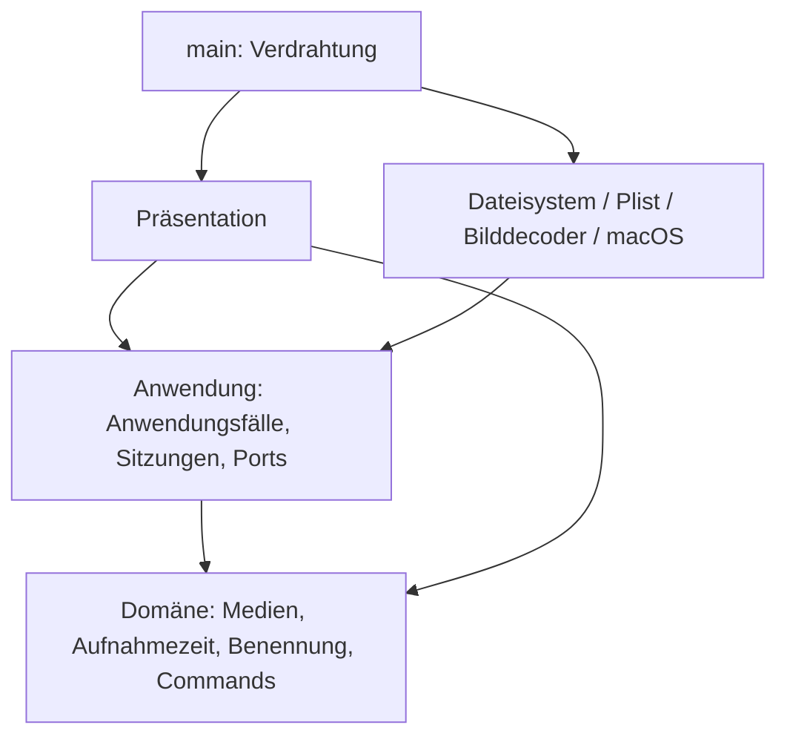

# Architekturprüfung der gesamten PhotoSuite

## Ziel und Abhängigkeitsrichtung

Clean Architecture mit pragmatischem DDD: fachliche Regeln klar abgrenzen, Anwendungsfälle unabhängig testen, Plattformdetails austauschbar halten. Optimierung richtet sich nach konkreten Anforderungen; die Architektur ist keine allgemeine Perfektionsgarantie.

`photosuite-domain` hängt ausschließlich von chrono ab; `photosuite-application` ausschließlich von der Domänen-Crate. Cargo verhindert Rückabhängigkeiten auf die Desktop-Crate. Beide Kern-Crates verbieten unsicheren Rust-Code. UI und Infrastruktur liegen weiterhin in derselben Desktop-Crate; ihre gegenseitige Trennung ist eine bewusst dokumentierte Modulkonvention.

## Vollständige Zuständigkeitsprüfung

| Bereich | Verantwortlichkeit / Befund |
|---|---|
| `crates/domain` | Private Medienfelder, unterstützte Formate, validierte Aufnahmezeit und Importbenennung; Gruppierung von Kollisionsnamen; Command-Identitäten und Rotationsregeln. Keine I/O- oder UI-Abhängigkeiten. Wiedergabe hat ausdrücklich keine Rotationswirkung. |
| `application` / `ports` | Laden/Filtern, frameworkunabhängige Schnittstellen und injizierte Dienste. Konkrete Implementierungen ausschließlich im Einstiegspunkt. |
| `editing` / `playback` | Eine laufende EXIF-Speicherung pro Sitzung; Fehler erhalten Sitzungskorrekturen. Wiedergabe validiert den Medientyp und delegiert an einen Plattformport. |
| `import` | Metadaten-/Namens-/Kollisionsablauf, Prüflauf, Fortschritt, strukturierter Abschluss und Abbruch. Keine Kopierbibliothek oder UI. |
| `duplicates` / `duplicate_review` | Alle Paare einer Gruppe prüfen; sichere Entfernungspläne; explizite Benutzerentscheidung; Workflow, Gruppenwechsel, Abbruch und abgeschlossene Aktionen in `ReviewSession`. UI steuert diese Übergänge nicht mehr selbst. |
| `preferences` | Preferences-Vertrag, Startpfadauswahl (expliziter Pfad vor gemerkter Bibliothek), Hintergrundspeicherung und vollständiges Abarbeiten beim normalen Beenden. Der Bibliothekspfad wird direkt beim Öffnen eingereiht, ohne auf das Scanergebnis zu warten. Abgebrochene Worker werden sichtbar gemeldet. |
| `storyboard` | Zeitliche Auswahl von sechs Frames und sequentieller Hintergrundauftrag. Keine Bild-/Video-Framework-Typen an der Grenze. |
| `presentation` | Zusammensetzung und Darstellungszustand. Toolbar, Bibliotheksnavigation, Fotowand und Großansicht sind eigene Unteransichten. |
| `options_ui` / `command_bindings` | Einheitliche Gruppen und Abstände, Eingaben, Beschriftungen, Kürzelkonflikte und persistierbare Darstellung der Kürzel. |
| `import_ui` / `duplicates_ui` | Pfadauswahl, Anzeigen von Fortschritt/Reports und Weitergabe von Entscheidungen. Duplikatworkflow wird unabhängig von der Sichtbarkeit des Fensters abgefragt. |
| `storyboard_ui` | Höchstens sechs Texturen für das aktuelle Video; Fortschritt und Einzelfehler. Alte Aufträge beim Wechsel freigeben. |
| `image_loader` | Zwei Worker, Queue mit 32 Plätzen, nicht blockierende Übergabe, generationsgeschützte Cache-Veröffentlichung und Fehler bei Decoderabbruch. Keine Fachregeln. |
| `infrastructure` | Read-only-Verzeichnisscan, Bildausrichtung, EXIF-Schreiben und Standardprogramm. Video-Frames werden über den in main injizierten Port geladen. |
| `import_fs` | Pfadprüfung, EXIF-Lesen, verifizierte temporäre Kopie, Veröffentlichung ohne Überschreiben. Quellschutz bleibt erhalten. |
| `duplicates_fs` | Konservativer Pixelvergleich, Farb-/Formatgrenzen, erneute Prüfung vor reversibler Dateibewegung und Bibliotheksgrenzen. |
| `preferences_fs` | XML-Plist, Schema-/Typprüfung, atomisches Speichern, Erhalten beschädigter/unbekannter Dateien. |
| `video` / native Adapter | Rust-FFI und Plattformfehler. Native Dateien nach Decodierung, Player und Dateisystem getrennt; gemeinsamer C-Header dokumentiert Speicherbesitz und Hauptthreadpflicht. |
| `main` / `build.rs` | Composition Root und Bau der nativen Adapter für die macOS-Zielarchitektur. Keine Domänenentscheidungen. |

## Bei dieser Prüfung korrigiert

1. **Duplikatworkflow in UI:** in die unabhängig testbare `ReviewSession` verlagert. GUI hält nur Auswahl und Darstellung.
2. **Abbruch verlor Abschlussquittungen:** laufende Jobs bleiben nach Abbruch zum Abfragen erhalten. Bereits erfolgte Papierkorbaktionen werden protokolliert und lösen eine Aktualisierung aus; es startet keine neue Gruppe.
3. **Unbegrenzte Threads pro Bild:** durch zwei Worker und eine begrenzte Warteschlange ersetzt. Volle Queue blockiert keinen UI-Frame.
4. **Veraltete Bildergebnisse:** generationsgebundene Veröffentlichung verhindert, dass ein alter Decoder nach Cacheinvalidierung ein neueres Ergebnis überschreibt.
5. **Dauerhafte Ladezustände nach Workerfehlern:** Bibliotheks-, Import- und Preferences-Abläufe erkennen unterbrochene Kanäle und melden einen Fehler.
6. **Versteckte native Video-Konstruktion:** `RasterDecoder` bekommt den Frame-Port injiziert; Produktionsverdrahtung zentralisiert.
7. **Große Präsentationsdatei:** Toolbar, Bibliotheksleiste, Fotowand und Viewer in eigene Präsentationsmodule zerlegt. Ein Escape im Viewer überspringt nicht mehr das nachfolgende Abfragen anderer Anwendungssitzungen.
8. **Vermischte native Zuständigkeiten:** `native/video.m`, `native/player.m` und `native/filesystem.m` mit gemeinsamem `photosuite.h` getrennt.
9. **Stille No-op-Rotation für Wiedergabe:** Rotationsregel liefert für einen Nicht-Rotationsbefehl ausdrücklich kein Ergebnis; der Anwendungsfall lehnt ihn ab.
10. **Idiomatik und unnötige Referenzen:** Clippy-Befunde bereinigt; keine pauschale Unterdrückung von Warnungen.

## Datei- und Metadatenschutz

Standardmäßig lesen. Nur ausdrücklich aktivierte neue EXIF-Drehungen schreiben JPEG-Orientierungsdaten ohne Pixelneukompression und ohne dauerhafte Sicherung. Explizite Importe schreiben ausschließlich geprüfte Kopien ins Ziel. Nur bestätigte Pixelduplikate dürfen nach Auswahl und erneuter Prüfung in den macOS-Papierkorb. Importquellen bleiben unverändert; keine endgültige Löschung. Sichtbare Fehler und konservative Vergleichsgrenzen gelten unverändert.

Dateischritte bilden keine globale Transaktion: abgeschlossene Kopien oder Papierkorbbewegungen bleiben nach Abbruch erhalten. Der Abbruch wird zwischen Arbeitsschritten geprüft; ein laufender OS-Aufruf ist nicht rückholbar. Dateiänderungen durch andere Programme unmittelbar während einer Operation bleiben ein grundsätzliches Nebenläufigkeitsthema; die vorhandenen Nachprüfungen ersetzen keine systemweite Dateisperre.

## Bewusst verbleibende Grenzen

- Der CPU-/GPU-Bildcache und die Protokolle sind weiterhin nicht global speicherbegrenzt. Die Arbeitsqueue ist jetzt begrenzt; ein LRU-Budget für alle Cache-Ebenen ist eine separate Betriebsverbesserung.
- Bestimmte Adapterfehler sind Strings; der Scan liefert weiterhin Medien und Fehleranzahl als Tupel. Für gezieltes Wiederholen und umfangreichere Fehleroberflächen wären benannte Fehler-/Reporttypen sinnvoll.
- Einige Hintergrundaufträge können während eines nativen Decodier-/Dateiaufrufs nicht sofort abbrechen. Beim normalen Beenden wartet Preferences-Persistenz auf ausstehende Schreibvorgänge.
- Die zentrale `Suite` hält weiterhin gemeinsamen Präsentationszustand; sie ist kein fachliches Aggregat. Fachliche Sitzungen bleiben in der Anwendung.
- UI- und Infrastrukturmodule werden nicht durch separate Desktop-Crates voneinander isoliert. Cargo schützt bereits die entscheidenden inneren Schichtgrenzen. Weitere Crates sind erst bei konkretem Bedarf sinnvoll.
- ExifTool bleibt für Schreiben sowie Video-/Audio-Aufnahmedaten erforderlich; macOS bestimmt die Codecunterstützung. HEIC/RAW und andere bereits dokumentierte Produktgrenzen bleiben bestehen.

Diese Grenzen sind im aktuellen Prototyp vertretbare Vereinfachungen, werden aber bei relevanten Erweiterungen erneut bewertet. Sie werden nicht als vollständig gelöst dargestellt.

## Prüfungen und dauerhafte Anforderungen

Kern-Tests ohne GUI, EXIF-Programme und reale Dateisystemzugriffe für Workflows, Regeln, Abbruch und Fehler. Integrationstests mit temporären Dateien für Metadaten, sichere Kopien und Pixelvergleich; native Tests für Video. Layouttests prüfen Fensterbreiten, ersetzen keine manuelle Sichtprüfung.

Neue Regressionen decken insbesondere Gruppenwechsel erst nach Entscheidung, Abbruch ohne Folgeschritt, begrenzte Bildparallelität, veraltete Cachegenerationen und unerwarteten Preferences-Workerabbruch ab. Echte Nutzerdateien werden in Tests nicht verändert.

Verbindlicher Abschluss: `cargo fmt --all --check`, `cargo clippy --workspace --all-targets -- -D warnings`, `cargo test --workspace`, `cargo build --workspace`. Bei Änderungen am nativen Player zusätzlich `tests/native_playback.m` ausführen. Die Architekturpflege ist in `AGENTS.md` als dauerhafte Projektanforderung festgelegt.

## Paketierung und Laufzeitressourcen

`scripts/macos_app.py` ist ein äußerer Build-/Installationsadapter ohne Abhängigkeit aus den Kern-Crates. `make app`, `make install` und `make pkg` unterscheiden Projektbau, explizite Systeminstallation und Erstellung eines macOS-Installers. Cargo-Hooks installieren keine Systemdateien.

`exiftool::ExifTool` kapselt die Auflösung des Laufzeithelfers. main erkennt den Bundle-Kontext und injiziert denselben Helfer in EXIF-Schreib- und Importadapter. In einer App wird über `/usr/bin/perl` ausschließlich das gebündelte Skript gestartet, einschließlich seiner mitgelieferten Module; eine fehlende Bundle-Ressource führt zum Fehler statt zum PATH-Fallback. Terminalversionen behalten den Entwicklungs-PATH. Das Paket nutzt darüber hinaus nur macOS-Systembibliotheken.

Paketprüfung und temporäre Installationstests sichern unabhängigen Finder-Start, bekannte Bundle-Identität, Kopieren aller Ressourcen, Ablehnen fremder/Symlink-Ziele und Zurückstellen einer vorhandenen App bei Austauschfehler ab. Der Status `--check-installation` startet keine UI und schreibt keine Preferences. Preferences bleiben außerhalb des App-Pakets; Updates verändern keine Fotoquellen.

Das App-Icon ist eine Projektressource unter `assets/app-icon/photosuite.png`. Der äußere Paketierungsadapter erzeugt die Auflösungsvarianten und das ICNS, registriert es in Info.plist und signiert erst anschließend. Die Paketprüfung verlangt das Icon; weder Domäne noch Anwendung kennen den Assetpfad oder macOS-Iconformate.

Die Großansicht nutzt zwei feste Aktionszeilen ohne horizontalen Scroller mit konstanter Höhe für alle Medientypen und Speicherzustände; Fotos werden horizontal zentriert. Das Importprotokoll zeigt standardmäßig typisierte Dateiergebnisse als virtualisierte einzeilige Übersicht. Die optionale Detailansicht verwendet Absätze mit variabler Höhe für vollständige Meldungen und Pfade; große Detailprotokolle werden weiterhin vollständig im Layout verarbeitet (zusätzlich zum unbeschränkten Protokollspeicher).

## Gemeinsames Galeriedesign

`src/theme.rs` kapselt ausschließlich Darstellungsregeln: Farbrollen, kompakte Typografie-/Abstandsregeln, kontrastreiche Widgetzustände, Flächen und Navigationsdarstellung. `presentation::create` installiert das Theme; bestehende Layouttests verwenden dasselbe Theme. Fachliche Filter, Command-Ausführung, Import und Bildtransformationen bleiben unverändert in ihren bisherigen Schichten. Das ist eine gemeinsame Präsentationshilfe, keine neue Anwendungsschicht.

`docs/DESIGN.md` dokumentiert das Design. README ist die GitHub-Einstiegsseite, das ausführliche bisherige Handbuch liegt in `docs/USER_GUIDE.md`. Versionierte Screenshots zeigen echte UI mit einer separat heruntergeladenen Demobibliothek; `scripts/create_demo_library.py` ist ein ausdrücklich auszuführendes Dokumentationswerkzeug und keine Laufzeitabhängigkeit. `main` erlaubt mit `PHOTOSUITE_PREFERENCES_PATH` einen expliziten alternativen Preferences-Pfad für isolierte manuelle Prüfungen; der reguläre macOS-Pfad bleibt unverändert. Die konkreten Stores werden weiterhin ausschließlich in main erzeugt und injiziert.

Das kompakte Theme verwendet mindestens 12 Punkte für Metadaten/Hilfstexte und explizite helle Sekundärtexte einschließlich Suchhinweisen. Kontrasttests prüfen normale und geöffnete Widgetzustände auf mindestens 7:1. Jahresgruppen starten eingeklappt; ein Interaktionstest prüft den Wechsel zur Monatsliste.

Das Theme setzt explizit `egui::Theme::Dark`, bevor es den Style installiert. So bleiben die eigenen dunklen Flächen und eguis Text-/Widgetfarben auch bei spät eintreffenden macOS-Systemtheme-Ereignissen konsistent. Ein Regressionstest untersucht gerenderte Textshapes einschließlich starker Jahresüberschriften und Standardbeschriftungen über Hell-/Dunkelwechsel hinweg.

## Audio-Diary: erster Entwurf

- **Domäne:** `MediaKind::Audio`, validierte Audio-Datumswahl in `audio_date`, `Recording` und `YearTimeline` in `diary`. Aufnahmezeit/Importbenennung führen Audio nach Jahr/diary; positive endliche Dauern und eine sortierte globale Zeitachse werden durch private Felder/Konstruktoren abgesichert. Dateigrenzen und Abschnittsanteile sind Fachregeln, keine UI-Berechnung.
- **Anwendung:** `diary::AudioSource` und `AudioPlayer` sind frameworkunabhängige technische Ports. `DiarySession` erlaubt höchstens einen laufenden Vorbereitungsauftrag; ein Abbruch bleibt bis zum Workerabschluss belegt, damit wiederholte Klicks keine unbegrenzten Decoderthreads starten. Die Sitzung sammelt alle Audiodateien eines Jahres im Hintergrund, meldet Fortschritt, verwirft nach Abbruch veraltete Ergebnisse und öffnet erst den vollständigen Verlauf über den Playerport auf dem UI-Thread. Ein Lesefehler verhindert die vollständige Vorbereitung sichtbar, statt einzelne Aufnahmen unbemerkt auszulassen. Der bestehende Import nutzt dieselben Kopier-/Kollisionsabläufe; Audio fällt ausdrücklich nicht unter die Video-Namenskollisionsabkürzung.
- **Adapter:** `audio::NativeAudioSource` probt Audio-/Videotracks und exakte Dauer über AVFoundation, liest ausgewählte Metadaten per gebündeltem ExifTool und delegiert die Priorisierung an die Domäne. `FileSystemRepository` erhält diesen Port injiziert, um Audio-MP4/MOV korrekt zu klassifizieren. Alle Scan-/Metadatenzugriffe bleiben im Hintergrund.
- **Darstellung:** `presentation/diary` zeigt Audio-Kacheln des gewählten Diary-Ordners mit Datum und Uhrzeit sowie Fortschritt; Gruppenwechsel verwirft eine noch laufende Vorbereitung. Der Suchfilter beeinflusst die Dateiansicht, nicht den Jahresverlauf. Eine laufende native Wiedergabe darf beim weiteren Betrachten der Fotos fortlaufen.
- **Native Wiedergabe:** `native/audio.m` erstellt eine `AVMutableComposition` aus den Originalassets, ohne eine neue Medien-Datei zu schreiben. Die native Hörleiste zeichnet Abschnitte anhand der Dateidauern; AVPlayer sucht in der globalen Kompositionszeit. Keine Playlist-/Queue-Ansicht. Die Komposition wird abseits des Hauptthreads aufgebaut; nur die Fenster-/Playersteuerung läuft auf dem Hauptthread. Timer und Player werden beim Schließen/Ersetzen freigegeben, generationengesicherte Seek-Callbacks verhindern Reaktivierung alter Sitzungen.
- **Datumsfallback:** vollständige eingebettete Aufnahmezeiten haben Vorrang. Containererzeugung ist weniger zuverlässig. Ohne diese Informationen wird zuerst ein vollständiger Datum-/Uhrzeit-Dateiname mit optionalen Bindestrichen/Unterstrichen oder ohne Trenner analysiert (z. B. `2023-12-27_22-51-32`); kanonische `aud_…`-Namen und getrennte numerische Kollisionszusätze bleiben unterstützt. Die Domäne validiert Kalender und Uhrzeit ohne zusätzliche Regex-Abhängigkeit; zuletzt wird das Dateisystem-Erstellungsdatum ausdrücklich als unbestätigter Fallback angezeigt. Datei-Änderungsdatum wird nie verwendet. Audio wird nicht neu kodiert und Audio-Metadaten werden nicht geschrieben. Das zusätzliche `serde_json` gehört ausschließlich zum äußeren ExifTool-Adapter.

Bekannte Grenzen: keine dynamische vollständige Systemformatliste, keine manuelle Datumszuweisung/Wellenform; Sortierung nach angegebenen lokalen Datumswerten ohne implizite Zeitzonenverschiebung. Dateiänderungen mit unveränderter Dauer während der Wiedergabe sind nicht durch Dateisperren ausgeschlossen. Sehr große Jahre erfordern entsprechend viele Assetreferenzen; einzelne Systemaufrufe sind nicht sofort abbrechbar. Laufzeitverfügbarkeit hängt von macOS-Codecs ab. Diese Grenzen werden in README erklärt.

`cargo test --workspace` enthält Datum-/Import-/Quellschutz-/Layouttests. `make test-audio` baut und startet `tests/native_audio.m` mit temporären stummen WAV-Dateien und prüft eine echte 1:3-Komposition sowie Suchen, Wiedergabe, Pause, Abbruch und Freigabe. Es öffnet kein Playerfenster und verändert keine Benutzerdateien. Eine manuelle Sichtprüfung ist damit nicht behauptet.

Der Import liefert pro bearbeiteter Datei genau einen `FileReport` mit Quelle, Datum, letztem Ziel und `FileDecision`, zusätzlich zu den bestehenden Diagnoseereignissen und dem strukturierten Gesamtabschluss. Die Präsentation bildet daraus die kompakte Standardansicht ohne Logtextanalyse. Kopie, Kollisionen und Abbruchverhalten bleiben unverändert.

## Diary-Raster, Uhrzeit und Bibliothekswiederherstellung

`DiaryCatalog` liest Datumsinformationen für das Kachelraster hinter dem AudioSource-Port im Hintergrund, ist pro Sitzung auf einen Auftrag begrenzt und wird bei Gruppen-/Bibliothekswechsel invalidiert. Beide Ansichten verwenden dieselbe Datumspriorität einschließlich Dateinamenfallback. Das Raster ist virtualisiert; die Vorschau ist ein gezeichnetes Audiosymbol, keine analysierte Wellenform. `CaptureTime` formatiert Datum/Uhrzeit und liefert zivile Uhrzeitwerte ohne versteckte Zeitzonenverschiebung. Der native Player erhält diese Werte getrennt von Diagnosebeschriftungen und berechnet die aktuelle Aufnahmeuhrzeit durch Addition der lokalen Segmentposition. Ein nativer Regressionstest prüft Mitternachtswechsel nach einem dateiübergreifenden Seek.

Der XML-Preferences-Adapter verwendet `de.photosuite.PhotoSuite.settings.plist`, damit manuelle atomare XML-Schreibvorgänge und macOS-CFPreferences für das eigentliche App-Domain nicht dieselbe Datei verwalten. Die bisherige `de.photosuite.PhotoSuite.plist` wird nur als Legacy-Quelle gelesen und bleibt unverändert. Die Anwendung stößt einen Startsnapshot auch ohne Einstellungsänderung an. Finder-/macOS-Argumente werden vor der Startpfadauswahl entfernt; ein neuer Startpfad ersetzt die gespeicherte Bibliothek erst nach erfolgreichem Scan eines regulären Verzeichnisses. Ein Import in eine andere Bibliothek verändert die aktuelle Ansicht und die gemerkte Auswahl nicht.

Dekorative Schriftzeichen wurden von Buttons entfernt; Vektoren für Audiokacheln sind unabhängig von Schrift-Glyphen. Layouttests prüfen die tatsächlich gerenderten Beschriftungen zusätzlich auf Glyphenabdeckung.
