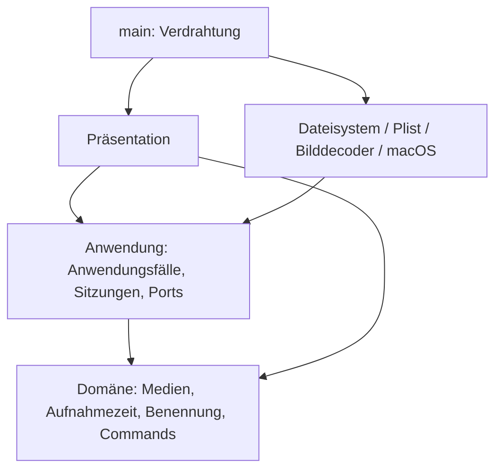

# Architekturprüfung der gesamten PhotoSuite

## Ziel und Abhängigkeitsrichtung

Clean Architecture mit pragmatischem DDD: fachliche Regeln klar abgrenzen, Anwendungsfälle unabhängig testen, Plattformdetails austauschbar halten. Optimierung richtet sich nach konkreten Anforderungen; die Architektur ist keine allgemeine Perfektionsgarantie.

`photosuite-domain` hängt ausschließlich von chrono ab; `photosuite-application` ausschließlich von der Domänen-Crate. Cargo verhindert Rückabhängigkeiten auf die Desktop-Crate. Beide Kern-Crates verbieten unsicheren Rust-Code. UI und Infrastruktur liegen weiterhin in derselben Desktop-Crate; ihre gegenseitige Trennung ist eine bewusst dokumentierte Modulkonvention.

## Vollständige Zuständigkeitsprüfung

| Bereich | Verantwortlichkeit / Befund |
|---|---|
| `crates/domain` | Private Medienfelder, unterstützte Formate, validierte Aufnahmezeit und Importbenennung; Gruppierung von Kollisionsnamen; Command-Identitäten und Rotationsregeln. Keine I/O- oder UI-Abhängigkeiten. Wiedergabe hat ausdrücklich keine Rotationswirkung. |
| `application` / `ports` | Laden/Filtern, frameworkunabhängige Schnittstellen und injizierte Dienste. Konkrete Implementierungen ausschließlich im Einstiegspunkt. |
| `editing` / `playback` | Eine laufende EXIF-Speicherung pro Sitzung; Fehler erhalten Sitzungskorrekturen. Wiedergabe validiert den Medientyp und delegiert an einen Plattformport. |
| `import` | Metadaten-/Namens-/Kollisionsablauf, Prüflauf, Fortschritt, strukturierter Abschluss und Abbruch. Keine Kopierbibliothek oder UI. |
| `duplicates` / `duplicate_review` | Alle Paare einer Gruppe prüfen; sichere Entfernungspläne; explizite Benutzerentscheidung; Workflow, Gruppenwechsel, Abbruch und abgeschlossene Aktionen in `ReviewSession`. UI steuert diese Übergänge nicht mehr selbst. |
| `preferences` | Preferences-Vertrag, Startpfadauswahl (expliziter Pfad vor gemerkter Bibliothek), Hintergrundspeicherung und vollständiges Abarbeiten beim normalen Beenden. Der Bibliothekspfad wird direkt beim Öffnen eingereiht, ohne auf das Scanergebnis zu warten. Abgebrochene Worker werden sichtbar gemeldet. |
| `storyboard` | Zeitliche Auswahl von sechs Frames und sequentieller Hintergrundauftrag. Keine Bild-/Video-Framework-Typen an der Grenze. |
| `presentation` | Zusammensetzung und Darstellungszustand. Toolbar, Bibliotheksnavigation, Fotowand und Großansicht sind eigene Unteransichten. |
| `options_ui` / `command_bindings` | Einheitliche Gruppen und Abstände, Eingaben, Beschriftungen, Kürzelkonflikte und persistierbare Darstellung der Kürzel. |
| `import_ui` / `duplicates_ui` | Pfadauswahl, Anzeigen von Fortschritt/Reports und Weitergabe von Entscheidungen. Duplikatworkflow wird unabhängig von der Sichtbarkeit des Fensters abgefragt. |
| `storyboard_ui` | Höchstens sechs Texturen für das aktuelle Video; Fortschritt und Einzelfehler. Alte Aufträge beim Wechsel freigeben. |
| `image_loader` | Zwei Worker, Queue mit 32 Plätzen, nicht blockierende Übergabe, generationsgeschützte Cache-Veröffentlichung und Fehler bei Decoderabbruch. Keine Fachregeln. |
| `infrastructure` | Read-only-Verzeichnisscan, Bildausrichtung, EXIF-Schreiben und Standardprogramm. Video-Frames werden über den in main injizierten Port geladen. |
| `import_fs` | Pfadprüfung, EXIF-Lesen, verifizierte temporäre Kopie, Veröffentlichung ohne Überschreiben. Quellschutz bleibt erhalten. |
| `duplicates_fs` | Konservativer Pixelvergleich, Farb-/Formatgrenzen, erneute Prüfung vor reversibler Dateibewegung und Bibliotheksgrenzen. |
| `preferences_fs` | XML-Plist, Schema-/Typprüfung, atomisches Speichern, Erhalten beschädigter/unbekannter Dateien. |
| `video` / native Adapter | Rust-FFI und Plattformfehler. Native Dateien nach Decodierung, Player und Dateisystem getrennt; gemeinsamer C-Header dokumentiert Speicherbesitz und Hauptthreadpflicht. |
| `main` / `build.rs` | Composition Root und Bau der nativen Adapter für die macOS-Zielarchitektur. Keine Domänenentscheidungen. |

## Bei dieser Prüfung korrigiert

1. **Duplikatworkflow in UI:** in die unabhängig testbare `ReviewSession` verlagert. GUI hält nur Auswahl und Darstellung.
2. **Abbruch verlor Abschlussquittungen:** laufende Jobs bleiben nach Abbruch zum Abfragen erhalten. Bereits erfolgte Papierkorbaktionen werden protokolliert und lösen eine Aktualisierung aus; es startet keine neue Gruppe.
3. **Unbegrenzte Threads pro Bild:** durch zwei Worker und eine begrenzte Warteschlange ersetzt. Volle Queue blockiert keinen UI-Frame.
4. **Veraltete Bildergebnisse:** generationsgebundene Veröffentlichung verhindert, dass ein alter Decoder nach Cacheinvalidierung ein neueres Ergebnis überschreibt.
5. **Dauerhafte Ladezustände nach Workerfehlern:** Bibliotheks-, Import- und Preferences-Abläufe erkennen unterbrochene Kanäle und melden einen Fehler.
6. **Versteckte native Video-Konstruktion:** `RasterDecoder` bekommt den Frame-Port injiziert; Produktionsverdrahtung zentralisiert.
7. **Große Präsentationsdatei:** Toolbar, Bibliotheksleiste, Fotowand und Viewer in eigene Präsentationsmodule zerlegt. Ein Escape im Viewer überspringt nicht mehr das nachfolgende Abfragen anderer Anwendungssitzungen.
8. **Vermischte native Zuständigkeiten:** `native/video.m`, `native/player.m` und `native/filesystem.m` mit gemeinsamem `photosuite.h` getrennt.
9. **Stille No-op-Rotation für Wiedergabe:** Rotationsregel liefert für einen Nicht-Rotationsbefehl ausdrücklich kein Ergebnis; der Anwendungsfall lehnt ihn ab.
10. **Idiomatik und unnötige Referenzen:** Clippy-Befunde bereinigt; keine pauschale Unterdrückung von Warnungen.

## Datei- und Metadatenschutz

Standardmäßig lesen. Nur ausdrücklich aktivierte neue EXIF-Drehungen schreiben JPEG-Orientierungsdaten ohne Pixelneukompression und ohne dauerhafte Sicherung. Explizite Importe schreiben ausschließlich geprüfte Kopien ins Ziel. Nur bestätigte Pixelduplikate dürfen nach Auswahl und erneuter Prüfung in den macOS-Papierkorb. Importquellen bleiben unverändert; keine endgültige Löschung. Sichtbare Fehler und konservative Vergleichsgrenzen gelten unverändert.

Dateischritte bilden keine globale Transaktion: abgeschlossene Kopien oder Papierkorbbewegungen bleiben nach Abbruch erhalten. Der Abbruch wird zwischen Arbeitsschritten geprüft; ein laufender OS-Aufruf ist nicht rückholbar. Dateiänderungen durch andere Programme unmittelbar während einer Operation bleiben ein grundsätzliches Nebenläufigkeitsthema; die vorhandenen Nachprüfungen ersetzen keine systemweite Dateisperre.

## Bewusst verbleibende Grenzen

- Der Galeriecache ist auf 256 MiB dekodierte RGBA-Daten und 1024 Einträge begrenzt; Verdrängung gibt auch die zugehörigen egui-Texturen frei. Temporäre Originaldekodierungen, laufende Frame-/Audioaufträge und Grafiktreiberressourcen kommen hinzu. Das vollständige Importprotokoll wächst absichtlich mit dem aktuellen Lauf und wird beim nächsten Lauf ersetzt.
- Bestimmte Adapterfehler sind Strings; der Scan liefert weiterhin Medien und Fehleranzahl als Tupel. Für gezieltes Wiederholen und umfangreichere Fehleroberflächen wären benannte Fehler-/Reporttypen sinnvoll.
- Einige Hintergrundaufträge können während eines nativen Decodier-/Dateiaufrufs nicht sofort abbrechen. Beim normalen Beenden wartet Preferences-Persistenz auf ausstehende Schreibvorgänge.
- Die zentrale `Suite` hält weiterhin gemeinsamen Präsentationszustand; sie ist kein fachliches Aggregat. Fachliche Sitzungen bleiben in der Anwendung.
- UI- und Infrastrukturmodule werden nicht durch separate Desktop-Crates voneinander isoliert. Cargo schützt bereits die entscheidenden inneren Schichtgrenzen. Weitere Crates sind erst bei konkretem Bedarf sinnvoll.
- ExifTool bleibt für Schreiben sowie Video-/Audio-Aufnahmedaten erforderlich; macOS bestimmt die Codecunterstützung. HEIC/RAW und andere bereits dokumentierte Produktgrenzen bleiben bestehen.

Diese Grenzen sind im aktuellen Prototyp vertretbare Vereinfachungen, werden aber bei relevanten Erweiterungen erneut bewertet. Sie werden nicht als vollständig gelöst dargestellt.

## Prüfungen und dauerhafte Anforderungen

Kern-Tests ohne GUI, EXIF-Programme und reale Dateisystemzugriffe für Workflows, Regeln, Abbruch und Fehler. Integrationstests mit temporären Dateien für Metadaten, sichere Kopien und Pixelvergleich; native Tests für Video. Layouttests prüfen Fensterbreiten, ersetzen keine manuelle Sichtprüfung.

Neue Regressionen decken insbesondere Gruppenwechsel erst nach Entscheidung, Abbruch ohne Folgeschritt, begrenzte Bildparallelität, veraltete Cachegenerationen und unerwarteten Preferences-Workerabbruch ab. Echte Nutzerdateien werden in Tests nicht verändert.

Verbindlicher Abschluss: `cargo fmt --all --check`, `cargo clippy --workspace --all-targets -- -D warnings`, `cargo test --workspace`, `cargo build --workspace`. Bei Änderungen am nativen Player zusätzlich `tests/native_playback.m` ausführen. Die Architekturpflege ist in `AGENTS.md` als dauerhafte Projektanforderung festgelegt.

## Paketierung und Laufzeitressourcen

`scripts/macos_app.py` ist ein äußerer Build-/Installationsadapter ohne Abhängigkeit aus den Kern-Crates. `make app`, `make install` und `make pkg` unterscheiden Projektbau, explizite Systeminstallation und Erstellung eines macOS-Installers. Cargo-Hooks installieren keine Systemdateien.

`exiftool::ExifTool` kapselt die Auflösung des Laufzeithelfers. main erkennt den Bundle-Kontext und injiziert denselben Helfer in EXIF-Schreib- und Importadapter. In einer App wird über `/usr/bin/perl` ausschließlich das gebündelte Skript gestartet, einschließlich seiner mitgelieferten Module; eine fehlende Bundle-Ressource führt zum Fehler statt zum PATH-Fallback. Terminalversionen behalten den Entwicklungs-PATH. Das Paket nutzt darüber hinaus nur macOS-Systembibliotheken.

Paketprüfung und temporäre Installationstests sichern unabhängigen Finder-Start, bekannte Bundle-Identität, Kopieren aller Ressourcen, Ablehnen fremder/Symlink-Ziele und Zurückstellen einer vorhandenen App bei Austauschfehler ab. Der Status `--check-installation` startet keine UI und schreibt keine Preferences. Preferences bleiben außerhalb des App-Pakets; Updates verändern keine Fotoquellen.

Das App-Icon ist eine Projektressource unter `assets/app-icon/photosuite.png`. Der äußere Paketierungsadapter erzeugt die Auflösungsvarianten und das ICNS, registriert es in Info.plist und signiert erst anschließend. Die Paketprüfung verlangt das Icon; weder Domäne noch Anwendung kennen den Assetpfad oder macOS-Iconformate.

Die Großansicht nutzt zwei feste Aktionszeilen ohne horizontalen Scroller mit konstanter Höhe für alle Medientypen und Speicherzustände; Fotos werden horizontal zentriert. Das Importprotokoll zeigt standardmäßig typisierte Dateiergebnisse als virtualisierte einzeilige Übersicht. Die optionale Detailansicht verwendet Absätze mit variabler Höhe für vollständige Meldungen und Pfade; große Detailprotokolle werden weiterhin vollständig im Layout verarbeitet (zusätzlich zum unbeschränkten Protokollspeicher).

## Gemeinsames Galeriedesign

`src/theme.rs` kapselt ausschließlich Darstellungsregeln: Farbrollen, kompakte Typografie-/Abstandsregeln, kontrastreiche Widgetzustände, Flächen und Navigationsdarstellung. `presentation::create` installiert das Theme; bestehende Layouttests verwenden dasselbe Theme. Fachliche Filter, Command-Ausführung, Import und Bildtransformationen bleiben unverändert in ihren bisherigen Schichten. Das ist eine gemeinsame Präsentationshilfe, keine neue Anwendungsschicht.

`docs/DESIGN.md` dokumentiert das Design. README ist die GitHub-Einstiegsseite, das ausführliche bisherige Handbuch liegt in `docs/USER_GUIDE.md`. Versionierte Screenshots zeigen echte UI mit einer separat heruntergeladenen Demobibliothek; `scripts/create_demo_library.py` ist ein ausdrücklich auszuführendes Dokumentationswerkzeug und keine Laufzeitabhängigkeit. `main` erlaubt mit `PHOTOSUITE_PREFERENCES_PATH` einen expliziten alternativen Preferences-Pfad für isolierte manuelle Prüfungen; der reguläre macOS-Pfad bleibt unverändert. Die konkreten Stores werden weiterhin ausschließlich in main erzeugt und injiziert.

Das kompakte Theme verwendet mindestens 12 Punkte für Metadaten/Hilfstexte und explizite helle Sekundärtexte einschließlich Suchhinweisen. Kontrasttests prüfen normale und geöffnete Widgetzustände auf mindestens 7:1. Jahresgruppen starten eingeklappt; ein Interaktionstest prüft den Wechsel zur Monatsliste.

Das Theme setzt explizit `egui::Theme::Dark`, bevor es den Style installiert. So bleiben die eigenen dunklen Flächen und eguis Text-/Widgetfarben auch bei spät eintreffenden macOS-Systemtheme-Ereignissen konsistent. Ein Regressionstest untersucht gerenderte Textshapes einschließlich starker Jahresüberschriften und Standardbeschriftungen über Hell-/Dunkelwechsel hinweg.

## Audio-Diary: erster Entwurf

- **Domäne:** `MediaKind::Audio`, validierte Audio-Datumswahl in `audio_date`, `Recording` in `diary`, `DiaryClip`/`DiaryTimeline` in `diary_timeline`. Aufnahmezeit/Importbenennung führen Audio nach Jahr/diary; positive endliche gemessene Dauern, getrennte vorläufige Dateigewichte und eine sortierte Jahresleiste werden durch private Felder/Konstruktoren abgesichert. Dateigrenzen und Abschnittsanteile sind Fachregeln, keine UI-Berechnung.
- **Anwendung:** `diary::AudioSource` und `AudioPlayer` sind frameworkunabhängige technische Ports. `DiarySession` erlaubt höchstens einen laufenden Vorbereitungsauftrag; ein Abbruch bleibt bis zum Workerabschluss belegt, damit wiederholte Klicks keine unbegrenzten Decoderthreads starten. Die Sitzung erstellt aus den bereits bekannten Dateinamen den vorläufigen Verlauf und öffnet ihn über den Playerport auf dem UI-Thread, ohne Größenabfragen über das ganze Jahr. Erst nach tatsächlichem Wiedergabestart prüft sie die einzelnen Aufnahmen, meldet Fortschritt und revidiert den Verlauf. Einzelfehler bleiben sichtbar am enthaltenen Clip, Abbruch verwirft verspätete Korrekturen. Der bestehende Import nutzt dieselben Kopier-/Kollisionsabläufe; Audio fällt ausdrücklich nicht unter die Video-Namenskollisionsabkürzung.
- **Adapter:** `audio::NativeAudioSource` probt Audio-/Videotracks und exakte Dauer über AVFoundation, liest ausgewählte Metadaten per gebündeltem ExifTool und delegiert die Priorisierung an die Domäne. `FileSystemRepository` erhält diesen Port injiziert, um Audio-MP4/MOV korrekt zu klassifizieren. Alle Scan-/Metadatenzugriffe bleiben im Hintergrund.
- **Darstellung:** `presentation/diary` zeigt Audio-Kacheln des gewählten Diary-Ordners mit Datum und Uhrzeit sowie Fortschritt; Gruppenwechsel verwirft eine noch laufende Vorbereitung. Der Suchfilter beeinflusst die Dateiansicht, nicht den Jahresverlauf. Eine laufende native Wiedergabe darf beim weiteren Betrachten der Fotos fortlaufen.
- **Native Wiedergabe:** `native/audio.m` erhält vorgeordnete Projektionen und steuert Fenster, Fotoleiste und Transport. `audio_timeline_view.*` zeichnet Gewichte und explizite Prüfzustände, ohne Dateizugriffe oder Sortierregeln. `audio_transport.*` lädt ausschließlich die aktive Originaldatei auf einem seriellen Worker; AVPlayer arbeitet mit echter lokaler Clipzeit. Der Controller projiziert diese Position auf die jeweilige Abschnittsbreite und wechselt am Dateiende zur nächsten Datei der aktuellen Reihenfolge. Es gibt keine Queue-/Playlist-Ansicht und keinen Jahreskompositionsaufbau. Aktualisierte Projektionen ersetzen niemals das aktive Item. Timer, Endbeobachter und Item werden beim Schließen/Ersetzen freigegeben; Generationen sichern asynchrone Lade-/Seek-Ergebnisse.
- **Datumsfallback:** vollständige eingebettete Aufnahmezeiten haben Vorrang. Containererzeugung ist weniger zuverlässig. Ohne diese Informationen wird zuerst ein vollständiger Datum-/Uhrzeit-Dateiname mit optionalen Bindestrichen/Unterstrichen oder ohne Trenner analysiert (z. B. `2023-12-27_22-51-32`); kanonische `aud_…`-Namen und getrennte numerische Kollisionszusätze bleiben unterstützt. Die Domäne validiert Kalender und Uhrzeit ohne zusätzliche Regex-Abhängigkeit; zuletzt wird das Dateisystem-Erstellungsdatum ausdrücklich als unbestätigter Fallback angezeigt. Datei-Änderungsdatum wird nie verwendet. Audio wird nicht neu kodiert und Audio-Metadaten werden nicht geschrieben. Das zusätzliche `serde_json` gehört ausschließlich zum äußeren ExifTool-Adapter.

Bekannte Grenzen: keine dynamische vollständige Systemformatliste, keine manuelle Datumszuweisung/Wellenform; Sortierung nach angegebenen lokalen Datumswerten ohne implizite Zeitzonenverschiebung. Dateiänderungen mit unveränderter Dauer während der Wiedergabe sind nicht durch Dateisperren ausgeschlossen. Sehr große Jahre erfordern viele nachgelagerte Metadatenprüfungen; einzelne Systemaufrufe sind nicht sofort abbrechbar. Laufzeitverfügbarkeit hängt von macOS-Codecs ab. Diese Grenzen werden in README erklärt.

`cargo test --workspace` enthält Datum-/Import-/Quellschutz-/Layouttests. `make test-audio` baut und startet `tests/native_audio.m` mit temporären stummen WAV-Dateien und prüft vorläufige Breiten/Farben, echte Wiedergabe, In-place-Umordnung mit unverändertem AVPlayerItem und lokaler Position, Suchen, Übergänge, Pause, Abbruch und Freigabe. Es öffnet kein Playerfenster und verändert keine Benutzerdateien. Eine manuelle Sichtprüfung ist damit nicht behauptet.

Der Import liefert pro bearbeiteter Datei genau einen `FileReport` mit Quelle, Datum, letztem Ziel und `FileDecision`, zusätzlich zu den bestehenden Diagnoseereignissen und dem strukturierten Gesamtabschluss. Die Präsentation bildet daraus die kompakte Standardansicht ohne Logtextanalyse. Kopie, Kollisionen und Abbruchverhalten bleiben unverändert.

## Diary-Raster, Uhrzeit und Bibliothekswiederherstellung

`DiaryCatalog` liest Datumsinformationen für das Kachelraster hinter dem AudioSource-Port im Hintergrund, ist pro Sitzung auf einen Auftrag begrenzt und wird bei Gruppen-/Bibliothekswechsel invalidiert. Beide Ansichten verwenden dieselbe Datumspriorität einschließlich Dateinamenfallback. Das Raster ist virtualisiert; die Vorschau ist ein gezeichnetes Audiosymbol, keine analysierte Wellenform. `CaptureTime` formatiert Datum/Uhrzeit und liefert zivile Uhrzeitwerte ohne versteckte Zeitzonenverschiebung. Der native Player erhält diese Werte getrennt von Diagnosebeschriftungen und berechnet die aktuelle Aufnahmeuhrzeit durch Addition der lokalen Segmentposition. Ein nativer Regressionstest prüft Mitternachtswechsel nach einem dateiübergreifenden Seek.

Der XML-Preferences-Adapter verwendet `de.photosuite.PhotoSuite.settings.plist`, damit manuelle atomare XML-Schreibvorgänge und macOS-CFPreferences für das eigentliche App-Domain nicht dieselbe Datei verwalten. Die bisherige `de.photosuite.PhotoSuite.plist` wird nur als Legacy-Quelle gelesen und bleibt unverändert. Die Anwendung stößt einen Startsnapshot auch ohne Einstellungsänderung an. Finder-/macOS-Argumente werden vor der Startpfadauswahl entfernt; ein neuer Startpfad ersetzt die gespeicherte Bibliothek erst nach erfolgreichem Scan eines regulären Verzeichnisses. Ein Import in eine andere Bibliothek verändert die aktuelle Ansicht und die gemerkte Auswahl nicht.

Dekorative Schriftzeichen wurden von Buttons entfernt; Vektoren für Audiokacheln sind unabhängig von Schrift-Glyphen. Layouttests prüfen die tatsächlich gerenderten Beschriftungen zusätzlich auf Glyphenabdeckung.

## Zeitliche Kontextfotos während der Audiowiedergabe

`domain::photo_context::PhotoTimeline` sortiert validierte Aufnahmezeiten und wählt fünf Nachbarn um das nächste Foto (Gleichstand: früheres Foto). Randplätze bleiben leer. `application::photo_context::PhotoContext` wartet zunächst auf die Freigabe durch tatsächliche native Wiedergabe. Erst dann liest ein Hintergrundauftrag über `ContextPhotoSource` Datumswerte aller Fotokandidaten der geöffneten Bibliothek. Der einmalige Index wird pro Player wiederverwendet. Anfragegenerationen bündeln Sprünge und verwerfen überholte Ergebnisse. Zwei Decoder laden maximal fünf benötigte Bilder parallel; ein Cache hält höchstens zehn PNGs mit Kante 384. Schließen setzt Abbruch und schließt den Anfragekanal; bereits laufende Adapteraufrufe enden regulär. Unerwartete Kanalabbrüche werden sichtbar gemeldet.

`PhotoContext` liest zuerst nur gültige Dateinamen. Für unbekannte Namen liest `src/context_photos.rs` bei der ergänzenden Suche EXIF DateTimeOriginal mit Rust; der Adapter behält seinen kanonischen Dateinamenfallback. Datumslose Fotos werden gezählt und ausgelassen; der Foto-Importfall erhält keinen neuen Fallback. `native/context_photos.m` erzeugt ausgerichtete, begrenzte PNGs über das macOS-Systemframework ImageIO ohne Schreibzugriffe. `main` injiziert diesen Port in `NativeAudioPlayer`. Die native Leiste meldet erste tatsächliche Wiedergabe, Clipwechsel und nach 250 ms beruhigte Seek-Ziele; keine sekundengenaue Neusuche. Der Desktop pumpt nur Ereignisse alle 100 ms, während der Player offen ist. Sitzungs- und Anfragekennungen schützen auch die native Ansicht vor alten Resultaten.

Die fünf nativen Fotoplätze füllen die echte Spurbreite; die Mitte erhält mehr Breite/Höhe. Zentrierter Aspect-Fill-Beschnitt und Datum/Uhrzeit unter jeder Kachel sind reine Darstellungsregeln. PNGs werden beim Übergang kopiert, FFI-Speicherbesitz ist im Header dokumentiert. Plattformtypen bleiben außerhalb des Kerns. Foto-Ladefehler stoppen kein Audio. Grenzen: erste Metadatensuche ohne geeignete Dateinamen kann dauern, Snapshot ohne Dateiwächter, keine Zeitabstandsgrenze und keine automatische Kamerazeitzonen-Korrektur. Nach Bibliotheksänderungen Player erneut öffnen. Automatisierte Kern-, ImageIO- und native Wiedergabetests prüfen diese Abläufe; eine manuelle Sichtprüfung ist damit nicht behauptet.

### Architekturprüfung: Beschriftung, Beschnitt und Rückweg zum Betrachter

Die Kontextfoto-Ansicht ist als `native/context_photo_view.h/.m` aus dem Audio-Controller herausgelöst. `PSContextPhotoSlot` bündelt Bild, Beschriftungen, Tooltip und Ladehinweis; parallele Listen und ihre Kopplung entfallen. Die Ansicht erhält ausdrücklich formatierte Datums-/Uhrzeitfelder, liest keine Dateien und interpretiert keine Tooltiptexte. Der Beschnitt verändert ausschließlich die gezeichnete Geometrie. `src/audio.rs` enthält Audio-Probe und Metadatenadapter; `src/audio_player.rs` enthält die davon getrennte native Playerbrücke. Beide bleiben äußere Adapter, in `main` verdrahtet.

Fotoklicks werden mit Sitzungs-/Anfragekennung und Slot gemeldet. Die Anwendungssitzung `PhotoContext` löst nur Slots ihrer aktuell veröffentlichten Auswahl zu Pfaden auf. Der frameworkfreie Port liefert sie über `AudioPlayerUpdate` zur Präsentation. `application::locate_photo` prüft die Zugehörigkeit zur aktuellen Sammlung und bestimmt das Bibliotheksjahr aus der vorhandenen Ordnerzuordnung. Die Präsentation setzt Jahresauswahl, sichtbare Filter und eine pfadgebundene Scroll-/Markierungsanforderung. Kein Bildbetrachter und kein Fokuswechsel werden ausgelöst; native Ansichten greifen nicht auf den Galerie-Zustand zu. Die virtualisierte Wand berechnet die Zielzeile aus aktuellen Spalten und Zeilenabständen, bevor sichtbare Zeilen erzeugt werden. Audio und Hintergrundprüfung laufen unverändert weiter.

Geprüfte Grenzen: Domäne bleibt fachlich (Zeitstempel/Nachbarauswahl), Anwendung steuert Hintergrundsuche/aktuelle Auswahl, Ports verwenden ausschließlich Rust-Standard-/Domänentypen, Adapter kapseln Dateisystem/ImageIO/FFI, Präsentation verwaltet Zeichnen/Fokus/Ansicht. Cargo erzwingt weiterhin Desktop → Anwendung → Domäne; innere Crates verbieten unsafe und enthalten keine Dateisystem-/GUI-Adapter. Gegenüber dem bisherigen Stand wurden die vermischte native Fotodarstellung und der gemeinsame Probe-/Playeradapter getrennt. Verbleibende Snapshot-, Cache- und Plattformgrenzen bleiben oben dokumentiert. Diese Prüfung ist bei jeder Änderung verbindlich, einschließlich kleiner UI-Korrekturen.

Regressionen: native Bitmaptests prüfen echte gefüllte Hoch-/Querformat-Kacheln, Geometrie an drei Breiten, Klickerkennung und explizite Beschriftungen. Anwendungstests verwerfen überholte Slotklicks. Präsentationstests prüfen die Portweitergabe zum bestehenden Betrachter, Ordnernavigation, unveränderte Diary-Filter und Ablehnen fremder Bibliothekspfade. Dies ersetzt keine manuelle Sichtprüfung.

## Zweistufiger Audio-Schnellstart

`DiaryTimeline` ersetzt das bisher ausschließlich vollständig vorbereitete `YearTimeline`-Modell. `DiaryClip::from_filename` besitzt zunächst nur ein optionales Dateinamen-Datum und ein gleiches vorläufiges Gewicht; eine echte Dauer existiert erst nach erfolgreicher Prüfung. Ungeprüfte Namensclips übernehmen nach ersten Ergebnissen das mittlere Gewicht geprüfter Clips. Der weiterhin nutzbare explizite Bytes-Konstruktor erhält Größenverhältnisse für bereits bekannte Werte. Geprüfte Clips verwenden `Dauer × 16000` als gemeinsame Layoutskala. Der feste Faktor ist keine ermittelte Bitrate: er verbindet lediglich die vorläufigen und gemessenen Gewichte während des Übergangs. Sobald alle Clips geprüft sind, kürzt er sich aus allen Breitenverhältnissen heraus. Diese Regel liegt ausschließlich in der Domäne; Adapter erhalten echte Sekunden separat. Private Felder verhindern ungültige gemessene Dauern, doppelte Pfade und nicht endliche Gewichte. Unbekannte Datumswerte werden nicht erfunden, sondern vorläufig hinter bekannten Zeitstempeln nach Pfad sortiert.

`DiarySession` baut den Entwurf ausschließlich aus bereits vorhandenen Dateinamen ohne Dateizugriff auf, veröffentlicht ihn und wartet danach auf die technische Rückmeldung `AudioPlaybackState.has_started`. Erst dann erfolgt pro Clip `inspect`, zuerst für die ausgewählte Aufnahme. Der native Adapter kombiniert eine native Probe mit der bestehenden Datumspriorität ohne frühere doppelte Probe. Ergebnisse laufen über einen auf zwei Ereignisse begrenzten Kanal. Die Anwendung aktualisiert den Entwurf, zählt Fehler und publiziert Revisionen über den frameworkfreien AudioPlayer-Port; UI-Callbacks steuern diesen Ablauf nicht. Bei Fehlern bleibt die betreffende Aufnahme mit vorläufigem Gewicht erhalten. Abbruch/Schließen beendet weitere Prüfungen; regulär laufende Aufrufe werden noch quittiert. Ein Kanalabbruch beendet den Ladezustand sichtbar.

`audio_player_projection.rs` verwaltet temporäre CString-/Array-Lebenszeiten für die synchrone C-Übergabe. Sitzungsschlüssel verhindern Revisionen eines ersetzten Players. Native View-Models enthalten Pfad, Gewicht, echte Dauer, Datum und Prüfzustand ausdrücklich getrennt. Die native Ansicht ermittelt nur geometrische Treffer; Domänensortierung, Datumsquellen und Gewichtsschätzung werden nicht dupliziert. Eine Korrektur ändert ausschließlich View-Models, nie das laufende Item oder seine Seek-Position. Die nächste Datei wird anhand der korrigierten Reihenfolge gewählt; eine Aufnahmezeitkorrektur invalidiert auch die Kontextfoto-Auswahl.

Bewusste Grenzen: vorläufige Startproportionen ohne bekannte Dauern, kein persistenter Dauercache, vorläufig ungenaue Sprünge über mehrere ungeprüfte Clips und mögliche kurze Ladepausen beim Dateiwechsel. Keine Dateien werden für Korrekturen umbenannt oder verschoben. Automatisierte Kern- und native Tests prüfen Freigabe erst nach Wiedergabestart, blockierte Prüfung bei bereits offenem Player, Teilfehler, Farbzustände, Umordnung, stabile Itemidentität/lokale Position, Seek, Übergang und Schließen. Screenshots/manuelle Prüfung bleiben getrennt.

Die Fensterreihenfolge nach Fotoklick wird ausschließlich im nativen UI-Adapter über `PSAudioCreateWindow` festgelegt: schwebend über normalen PhotoSuite-Fenstern, beim Wechsel zu anderen Anwendungen ausgeblendet. Fotoklicks verändern nur die Hintergrundgalerie und fordern keinen Fokuswechsel mehr an. Domäne, Anwendung und Ports benötigen dafür keine Fensterreferenzen oder neuen Zustände. Ein nativer Regressionstest prüft die tatsächlich erzeugte Fensterkonfiguration ohne manuelle Sichtprüfung.

## Vertiefter Review vom 08.11.2026

Prüfung und Korrekturen sind in [docs/ARCHITECTURE_REVIEW.md](docs/ARCHITECTURE_REVIEW.md) beschrieben. Neue Anwendungsfälle: `collection::CollectionSession`, `storyboard::StoryboardSession`, `import_session::ImportSession`. Die UI wertet deren technische Kanäle nicht mehr selbst aus. `DecodedImage` schützt die Pixelinvarianten an der technischen Portgrenze; Command-IDs und Foto-Dateinamenvalidierung haben jeweils eine gemeinsame Domänenquelle. Preferences verwenden einen einzelnen ersetzbaren Snapshot statt einer unbeschränkten Queue. Galerie- und Großansichtsvorschauen besitzen getrennte Auflösungsidentitäten und ein begrenztes Cache-Budget. Präsentationstests liegen getrennt unter `src/presentation/tests.rs`.

`make check-architecture` prüft die freigegebenen Kernabhängigkeiten anhand von Cargo-Metadaten. Die Modulkonvention zwischen UI und Infrastruktur innerhalb der Desktop-Crate bleibt zusätzlich reviewpflichtig. Diese Prüfung garantiert keine generelle Fehlerfreiheit oder harte Obergrenze für den gesamten Prozessspeicher.

Die Kontextfoto-Aktion heißt am Port `photo_to_reveal`. Dateipfade bleiben die Identität für Markierung und einmaligen Scrollauftrag; Bibliothekswechsel und manuelle Gruppenwechsel räumen diese Zustände auf. Fotos außerhalb einer gültigen Jahresstruktur werden in der Gesamtübersicht lokalisiert. Layouttests prüfen ein weit außerhalb des sichtbaren Bereichs liegendes Foto bei schmalen/breiten Fenstern und drei Zoomstufen, einschließlich sichtbarem Rahmen und ausbleibendem Focus-Viewportbefehl.

## Zweiphasige Freigabe von Importquellen

`ImportSession` erstellt einen `CleanupRequest` aus eingefrorenen Quell-/Zielwurzeln und typisierten FileReports des tatsächlichen Importlaufs. Prüfläufe sind ausgeschlossen. `import_cleanup::CleanupSession` verwaltet Prüfung, Freigabe, ausdrückliche Bestätigung, Fortschritt, Abbruch und Abschlussquittungen über einen begrenzten Ereigniskanal. Die UI rendert ausschließlich Zeilen und stößt Start/Bestätigung an. Während der Freigabe werden neue Import-/Duplikataktionen in derselben Oberfläche gesperrt.

Ein injizierter `CleanupPort` prüft die konkrete Quelle gegen das konkrete Ziel. `SafeImportCleanup` kapselt kanonische Ordnergrenzen, Symlink-/Hardlink-/Leerdateiprüfung, vollständigen Bytevergleich und Dateiversionen (Gerät, Inode, Größe, mtime/ctime inklusive Nanosekunden). Freigaben halten diese Versionen sowie die Quell-/Zielordneridentität fest. Vor dem Verschieben wird erneut verglichen und die Freigabe auf unveränderte Versionen geprüft. Ein separat injizierter `Trash`-Port führt ausschließlich die reversible OS-Papierkorbaktion aus; alle Produktionsadapter werden in main verdrahtet. Es gibt kein remove_file-Fallback in der Produktion.

Bestätigte Erfolgsquittungen bleiben auch nach Abbruch erhalten. Noch nicht gestartete Quellen werden nicht angefasst; ein laufender OS-Aufruf kann enden. Ein Marker vor dem Aufruf erlaubt es, einen Worker-Abbruch während einer Aktion als „Status unklar“ darzustellen, statt fälschlich Erhalt oder Löschung zu behaupten. Zieldateien und ganze Verzeichnisse sind keine Entfernungsziele. Die Bestätigung ist nur einmal pro vollständiger Prüfung möglich.

Tests verwenden In-Memory-Ports und ausschließlich selbst angelegte temporäre Dateien mit einem simulierten Papierkorb. Abgedeckt sind Bestätigungsgrenze, fehlende/veränderte Ziele, Inhaltsabweichung, identischer Ersatz mit neuer Inode, Symlinks/Hardlinks, leere Dateien, Abbruch während laufender Operation, Teilquittungen und unklare Abschlusszustände. Keine echte Benutzerdatei wird in Tests in den macOS-Papierkorb verschoben. Grenzen: kein persistentes Importarchiv und keine systemweite Sperre gegen externe Änderungen nach der letzten Prüfung. Der eigentliche Import bleibt weiterhin rein kopierend.

### Schrittweises Bibliotheksladen
`CollectionSession` liest über `MediaRepository::partitions` zuerst einen flachen, ausschließlich lesenden Verzeichnisindex. `scan_partition` lädt danach einzelne Jahre (sowie Dateien direkt im Bibliotheksordner); Gruppenzuordnungen bleiben relativ zur ursprünglichen Bibliothek. Nur ein Worker ist aktiv, der Ergebniskanal ist auf zwei Ereignisse begrenzt. Die Anwendung liefert append-only Medienbatches und hält nur einen kleinen Gruppenindex, keine zweite vollständige Medienliste. Die Präsentation hängt neue Batches an; vorhandene Betrachterindizes bleiben stabil. Jahres-/Monatsgruppen werden nicht mehr bei jedem Bildaufbau aus der gesamten Sammlung sortiert.

Ein aufgeklapptes Jahr wird als neueste Priorität gespeichert. Ein anderer laufender Jahresscan wird kooperativ unterbrochen; dessen unvollständiger Batch wird verworfen und später vollständig wiederholt. Bereits abgeschlossene und aktuell gescannte Jahre lösen keinen Neustart aus. Bibliothekswechsel verwerfen alte Ereignisse, bevor der neueste Auftrag startet. Abschluss und unerwartetes Workerende sind getrennte Ereignisse. Leere Jahre erscheinen ebenfalls; symbolische Verzeichnislinks werden nicht verfolgt. Decoder-/Codecaufrufe können nicht sofort abgebrochen werden. Die erste Jahresansicht erscheint nach dem Lesen dieses Jahres; Vorschauen werden weiterhin separat und begrenzt nachgeladen. Es gibt keine Schreib-, Verschiebe- oder Löschoperation im Ladepfad.

### Portable Importveröffentlichung (exFAT)
Die Strategie bleibt vollständig im Dateisystemadapter `import_fs`; Anwendungsport, Kollisionsregeln und UI benötigen keine Plattformkenntnisse. Stagingdateien tragen eindeutige Namen mit `.tmp`-Suffix. `persist_noclobber` bleibt der schnelle Weg. Ausschließlich ein Unsupported-Fehler (einschließlich macOS errno 45) aktiviert `publish_portable`: `create_new`/O_EXCL statt gewöhnlichem Rename, zusätzliche Kopie aus dem geprüften Stagingfile, Sync und voller Vergleich mit Staging und Quelle. Andere Fehler bleiben sichtbar und werden nicht verschleiert. Erfolg wird erst nach vollständiger Prüfung quittiert. Bei Fehler/Abbruch wird das selbst erzeugte Ziel nur nach erneuter Geräte-/Inode-Prüfung entfernt; ersetzte fremde Pfade bleiben erhalten. Die Quelle wird nie verändert.

Der Ersatzweg erhält die Nichtüberschreibgarantie bei der Neuanlage, bietet aber keine atomare Sichtbarkeit und keine Transaktion bei Prozess-/Systemabsturz. Er benötigt zusätzliche IO und temporären Speicherplatz. Zeitgleiche Fremdänderungen sind nicht global gesperrt; Identitätsprüfungen reduzieren das Risiko, ersetzen keine Dateisystemsperre. Regressionstests injizieren Unsupported-Persistenzfehler und prüfen Kopierinhalt, Kollisionen, Symlinks, Quellenänderungen, Abbruch und sonstige Fehler ausschließlich mit temporären Testdateien. Ein tatsächlich angeschlossenes exFAT-Laufwerk wird dadurch nicht simuliert.

### Architekturprüfung: dateinamenbasierter Schnellstart und Audio-Vorrang
- **Domäne:** `CaptureTime` hält den beim Validieren berechneten zivilen Sekundenwert, statt ihn bei jedem Sortiervergleich erneut zu parsen. `DiaryClip::from_filename` und `DiaryTimeline::refine` sichern vorläufige Gewichte und deren Anpassung; keine UI-/Adapterheuristik dafür. `Media::from_library_path` kennzeichnet Container im Diary zunächst als Audiokandidaten. Der bestätigte Audio-Konstruktor bleibt für tatsächlich geprüfte Tracks.
- **Anwendung:** `DiarySession` öffnet ohne Stat-/Decoderaufrufe über die gesamte Liste; der obsolete `AudioSource::file_size`-Port entfällt. `DiaryCatalog` verwendet unmittelbar vollständige Namen und liest nur fehlende Daten nach. `PhotoContext` baut den schnellen Namensindex ohne I/O auf. Bei gemischten Sammlungen ergänzt ein eigener, erst nach ersten Vorschauen freigegebener Metadatenworker unbekannte Namen über einen auf 16 Ereignisse begrenzten Kanal. Neue Clipanfragen werden unabhängig davon verarbeitet; explizites Ende und unerwarteter Worker-Ausfall sind getrennt. Ergänzungen werden gebündelt im bestehenden `PhotoTimeline` einsortiert, keine zweite volle Indexkopie. Ein reiner Altbestand ohne auswertbare Namen nutzt den bestehenden EXIF-Fallback.
- **Ressourcensteuerung:** `work_priority::WorkPriority` ist ein eigener Anwendungsdienst mit RAII-Lease. `DiarySession` beansprucht ihn vor dem Start bis zur tatsächlichen Wiedergabe und Prüfung der gewählten Aufnahme; Fehler/Abbruch/Panik geben ihn wieder frei, laufende OS-Aufrufe dürfen regulär enden. Galerie-Scans, normale Rasterdecoder, Diary-Datumsabfragen und ergänzende Foto-Metadaten warten kooperativ. Die fünf gezielt angeforderten Kontextvorschauen dürfen nach tatsächlichem Wiedergabestart parallel laden. Metadatenports bleiben reine Metadatenports und enthalten keine Scheduler-Getter.
- **Adapter/Composition Root:** `main` erzeugt genau einen gemeinsamen Prioritätsdienst und injiziert ihn in Dienste, Repository, Rasterdecoder und nativen Audioplayer. Die Präsentation injiziert ihn in die beiden Anwendungssitzungen. Galerie-Partitionsscans führen keine AVFoundation-Probes mehr aus; der Import benutzt weiterhin den vollständigen Scan und die bisherigen strengen Prüfungen. Der native Transport lädt mit User-Initiated-QoS und ohne erzwungene präzise Vorabanalyse. Start bei Position null benötigt keinen anfänglichen Seek. Gemessene Dauern werden pfadgebunden ohne Itemwechsel oder Repositionieren übernommen.
- **Grenzen:** Namensdaten sind im Kontextindex und Diary-Raster maßgeblich, statt für jedes korrekt benannte Foto/Audiokachel erneut EXIF/Containerdaten einzulesen. Abweichungen werden für Audio bei der Playerprüfung und beim Import berücksichtigt. Der Fotoindex verwendet die beim Playerstart bereits geladene Sammlung; nach weiterem Laden erneut öffnen. Keine harte Echtzeitgarantie, keine globalen I/O-Sperren und kein persistenter Dauercache. Keine Dateien werden verändert oder gelöscht.

### Nachprüfung versteckter Importdateien
Die Medienfabriken der Domäne schließen reservierte `._`-Begleitnamen als Zusatzmetadaten aus; die Regel gilt für Gallery-/Importsuche und bestätigte Audio-Assets. Nicht alle Punktdateien werden pauschal ausgeschlossen. Der technische Dateisystemadapter übernimmt weiterhin ausschließlich die Bereinigung der selbst erzeugten Stagingdateien. Er verlässt sich auf normalen Fehler-, Abbruch- und portablen Veröffentlichungspfaden nicht mehr auf best-effort `tempfile::Drop`, sondern prüft Dateiidentität, schließt den eigenen Handle und meldet Entfernen-Fehler mit Pfad. Fremd ersetzte Pfade werden erhalten; die automatische Drop-Bereinigung wird für diese explizite Prüfung deaktiviert. Der schnelle erfolgreiche `persist_noclobber`-Pfad bleibt bei der Bibliotheksimplementierung; bei internem Hardlink-Fallback kann deren unlink-Best-Effort ebenfalls Überreste hinterlassen.

Tests prüfen unveränderte AppleDouble-Dateien bei ignorierter Medienerkennung, erhaltene andere versteckte Medien, Erfolg/Abbruch/Fehler des portablen Imports, sichtbar gemeldete Bereinigungsfehler, bereits fehlende Stagingpfade und Schutz fremd ersetzter Pfade. Keine bestehenden Benutzerdateien werden bereinigt. Dateisystemweite Sperren oder eine Absturzgarantie gibt es nicht.

### Kompakte Bibliotheksnavigation
Breitenbelegung, Zeilenhöhe und Scrollbalkenposition bleiben reine Präsentationsregeln: `presentation/library` setzt einen vollbreiten Scrollbereich und lokale kompakte Abstände; `theme::navigation` stellt volle Klickflächen mit 20 Punkten Höhe bereit. Gruppierung, priorisiertes Laden und Auswahlregeln werden unverändert über die vorhandenen Anwendungssitzungen benutzt. Domäne, Ports und Adapter erhalten keine Layoutabhängigkeiten. Gerenderte UI-Regressionen prüfen drei Fensterbreiten, zwölf Monatszeilen, die Scrollbalkenposition und tatsächliche Klicks am rechten Zeilenrand.
