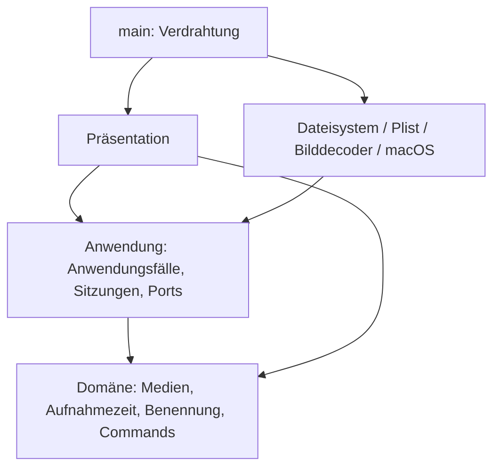

# Architekturprüfung der gesamten PhotoSuite

## Ziel und Abhängigkeitsrichtung

Clean Architecture mit pragmatischem DDD: fachliche Regeln klar abgrenzen, Anwendungsfälle unabhängig testen, Plattformdetails austauschbar halten. Optimierung richtet sich nach konkreten Anforderungen; die Architektur ist keine allgemeine Perfektionsgarantie.

`photosuite-domain` hängt ausschließlich von chrono ab; `photosuite-application` ausschließlich von der Domänen-Crate. Cargo verhindert Rückabhängigkeiten auf die Desktop-Crate. Beide Kern-Crates verbieten unsicheren Rust-Code. UI und Infrastruktur liegen weiterhin in derselben Desktop-Crate; ihre gegenseitige Trennung ist eine bewusst dokumentierte Modulkonvention.

## Vollständige Zuständigkeitsprüfung

| Bereich | Verantwortlichkeit / Befund |
|---|---|
| `crates/domain` | Private Medienfelder, unterstützte Formate, validierte Aufnahmezeit und Importbenennung; Gruppierung von Kollisionsnamen; Command-Identitäten und Rotationsregeln. Keine I/O- oder UI-Abhängigkeiten. Wiedergabe hat ausdrücklich keine Rotationswirkung. |
| `application` / `ports` | Laden/Filtern, frameworkunabhängige Schnittstellen und injizierte Dienste. Konkrete Implementierungen ausschließlich im Einstiegspunkt. |
| `editing` / `playback` | Eine laufende EXIF-Speicherung pro Sitzung; Fehler erhalten Sitzungskorrekturen. Wiedergabe validiert den Medientyp und delegiert an einen Plattformport. |
| `import` | Metadaten-/Namens-/Kollisionsablauf, Prüflauf, Fortschritt, strukturierter Abschluss und Abbruch. Keine Kopierbibliothek oder UI. |
| `duplicates` / `duplicate_review` | Alle Paare einer Gruppe prüfen; sichere Entfernungspläne; explizite Benutzerentscheidung; Workflow, Gruppenwechsel, Abbruch und abgeschlossene Aktionen in `ReviewSession`. UI steuert diese Übergänge nicht mehr selbst. |
| `preferences` | Preferences-Vertrag, Startpfadauswahl (expliziter Pfad vor gemerkter Bibliothek), Hintergrundspeicherung und vollständiges Abarbeiten beim normalen Beenden. Der Bibliothekspfad wird direkt beim Öffnen eingereiht, ohne auf das Scanergebnis zu warten. Abgebrochene Worker werden sichtbar gemeldet. |
| `storyboard` | Zeitliche Auswahl von sechs Frames und sequentieller Hintergrundauftrag. Keine Bild-/Video-Framework-Typen an der Grenze. |
| `presentation` | Zusammensetzung und Darstellungszustand. Fenstertitel/Fußzeile, Bibliotheksnavigation, Fotowand und Großansicht sind eigene Unteransichten. |
| `options_ui` / `command_bindings` | Einheitliche Gruppen und Abstände, Eingaben, Beschriftungen, Kürzelkonflikte und persistierbare Darstellung der Kürzel. |
| `import_ui` / `duplicates_ui` | Pfadauswahl, Anzeigen von Fortschritt/Reports und Weitergabe von Entscheidungen. Duplikatworkflow wird unabhängig von der Sichtbarkeit des Fensters abgefragt. |
| `storyboard_ui` | Höchstens sechs Texturen für das aktuelle Video; Fortschritt und Einzelfehler. Alte Aufträge beim Wechsel freigeben. |
| `image_loader` | Zwei Worker, Queue mit 32 Plätzen, nicht blockierende Übergabe, generationsgeschützte Cache-Veröffentlichung und Fehler bei Decoderabbruch. Keine Fachregeln. |
| `infrastructure` | Read-only-Verzeichnisscan, Bildausrichtung, EXIF-Schreiben und Standardprogramm. Video-Frames werden über den in main injizierten Port geladen. |
| `import_fs` | Pfadprüfung, EXIF-Lesen, verifizierte temporäre Kopie, Veröffentlichung ohne Überschreiben. Quellschutz bleibt erhalten. |
| `duplicates_fs` | Konservativer Pixelvergleich, Farb-/Formatgrenzen, erneute Prüfung vor reversibler Dateibewegung und Bibliotheksgrenzen. |
| `preferences_fs` / `library_preferences_fs` / `preferences_codec` | Legacy-Plist als Migrationsquelle, gemeinsamer Codec, bibliotheksbezogenes YAML und lokaler reiner Pfadverweis. Schema-/Typprüfung und atomisches Speichern bleiben äußere Aufgaben. |
| `video` / native Adapter | Rust-FFI und Plattformfehler. Native Dateien nach Decodierung, Player und Dateisystem getrennt; gemeinsamer C-Header dokumentiert Speicherbesitz und Hauptthreadpflicht. |
| `main` / `build.rs` | Composition Root und Bau der nativen Adapter für die macOS-Zielarchitektur. Keine Domänenentscheidungen. |

## Bei dieser Prüfung korrigiert

1. **Duplikatworkflow in UI:** in die unabhängig testbare `ReviewSession` verlagert. GUI hält nur Auswahl und Darstellung.
2. **Abbruch verlor Abschlussquittungen:** laufende Jobs bleiben nach Abbruch zum Abfragen erhalten. Bereits erfolgte Papierkorbaktionen werden protokolliert und lösen eine Aktualisierung aus; es startet keine neue Gruppe.
3. **Unbegrenzte Threads pro Bild:** durch zwei Worker und eine begrenzte Warteschlange ersetzt. Volle Queue blockiert keinen UI-Frame.
4. **Veraltete Bildergebnisse:** generationsgebundene Veröffentlichung verhindert, dass ein alter Decoder nach Cacheinvalidierung ein neueres Ergebnis überschreibt.
5. **Dauerhafte Ladezustände nach Workerfehlern:** Bibliotheks-, Import- und Preferences-Abläufe erkennen unterbrochene Kanäle und melden einen Fehler.
6. **Versteckte native Video-Konstruktion:** `RasterDecoder` bekommt den Frame-Port injiziert; Produktionsverdrahtung zentralisiert.
7. **Große Präsentationsdatei:** Toolbar, Bibliotheksleiste, Fotowand und Viewer in eigene Präsentationsmodule zerlegt. Ein Escape im Viewer überspringt nicht mehr das nachfolgende Abfragen anderer Anwendungssitzungen.
8. **Vermischte native Zuständigkeiten:** `native/video.m`, `native/player.m` und `native/filesystem.m` mit gemeinsamem `photosuite.h` getrennt.
9. **Stille No-op-Rotation für Wiedergabe:** Rotationsregel liefert für einen Nicht-Rotationsbefehl ausdrücklich kein Ergebnis; der Anwendungsfall lehnt ihn ab.
10. **Idiomatik und unnötige Referenzen:** Clippy-Befunde bereinigt; keine pauschale Unterdrückung von Warnungen.

## Datei- und Metadatenschutz

Standardmäßig lesen. Nur ausdrücklich aktivierte neue EXIF-Drehungen schreiben JPEG-Orientierungsdaten ohne Pixelneukompression und ohne dauerhafte Sicherung. Explizite Importe schreiben ausschließlich geprüfte Kopien ins Ziel. Nur bestätigte Pixelduplikate dürfen nach Auswahl und erneuter Prüfung in den macOS-Papierkorb. Importquellen bleiben unverändert; keine endgültige Löschung. Sichtbare Fehler und konservative Vergleichsgrenzen gelten unverändert.

Dateischritte bilden keine globale Transaktion: abgeschlossene Kopien oder Papierkorbbewegungen bleiben nach Abbruch erhalten. Der Abbruch wird zwischen Arbeitsschritten geprüft; ein laufender OS-Aufruf ist nicht rückholbar. Dateiänderungen durch andere Programme unmittelbar während einer Operation bleiben ein grundsätzliches Nebenläufigkeitsthema; die vorhandenen Nachprüfungen ersetzen keine systemweite Dateisperre.

## Bewusst verbleibende Grenzen

- Der Galeriecache ist auf 256 MiB dekodierte RGBA-Daten und 1024 Einträge begrenzt; Verdrängung gibt auch die zugehörigen egui-Texturen frei. Temporäre Originaldekodierungen, laufende Frame-/Audioaufträge und Grafiktreiberressourcen kommen hinzu. Das vollständige Importprotokoll wächst absichtlich mit dem aktuellen Lauf und wird beim nächsten Lauf ersetzt.
- Bestimmte Adapterfehler sind Strings; der Scan liefert weiterhin Medien und Fehleranzahl als Tupel. Für gezieltes Wiederholen und umfangreichere Fehleroberflächen wären benannte Fehler-/Reporttypen sinnvoll.
- Einige Hintergrundaufträge können während eines nativen Decodier-/Dateiaufrufs nicht sofort abbrechen. Beim normalen Beenden wartet Preferences-Persistenz auf ausstehende Schreibvorgänge.
- Die zentrale `Suite` hält weiterhin gemeinsamen Präsentationszustand; sie ist kein fachliches Aggregat. Fachliche Sitzungen bleiben in der Anwendung.
- UI- und Infrastrukturmodule werden nicht durch separate Desktop-Crates voneinander isoliert. Cargo schützt bereits die entscheidenden inneren Schichtgrenzen. Weitere Crates sind erst bei konkretem Bedarf sinnvoll.
- ExifTool bleibt für Schreiben sowie Video-/Audio-Aufnahmedaten erforderlich; macOS bestimmt die Codecunterstützung. HEIC/RAW und andere bereits dokumentierte Produktgrenzen bleiben bestehen.

Diese Grenzen sind im aktuellen Prototyp vertretbare Vereinfachungen, werden aber bei relevanten Erweiterungen erneut bewertet. Sie werden nicht als vollständig gelöst dargestellt.

## Prüfungen und dauerhafte Anforderungen

Kern-Tests ohne GUI, EXIF-Programme und reale Dateisystemzugriffe für Workflows, Regeln, Abbruch und Fehler. Integrationstests mit temporären Dateien für Metadaten, sichere Kopien und Pixelvergleich; native Tests für Video. Layouttests prüfen Fensterbreiten, ersetzen keine manuelle Sichtprüfung.

Neue Regressionen decken insbesondere Gruppenwechsel erst nach Entscheidung, Abbruch ohne Folgeschritt, begrenzte Bildparallelität, veraltete Cachegenerationen und unerwarteten Preferences-Workerabbruch ab. Echte Nutzerdateien werden in Tests nicht verändert.

Verbindlicher Abschluss: `cargo fmt --all --check`, `cargo clippy --workspace --all-targets -- -D warnings`, `cargo test --workspace`, `cargo build --workspace`. Bei Änderungen am nativen Player zusätzlich `tests/native_playback.m` ausführen. Die Architekturpflege ist in `AGENTS.md` als dauerhafte Projektanforderung festgelegt.

## Paketierung und Laufzeitressourcen

`scripts/macos_app.py` ist ein äußerer Build-/Installationsadapter ohne Abhängigkeit aus den Kern-Crates. `make app`, `make install` und `make pkg` unterscheiden Projektbau, explizite Systeminstallation und Erstellung eines macOS-Installers. Cargo-Hooks installieren keine Systemdateien.

`exiftool::ExifTool` kapselt die Auflösung des Laufzeithelfers. main erkennt den Bundle-Kontext und injiziert denselben Helfer in EXIF-Schreib- und Importadapter. In einer App wird über `/usr/bin/perl` ausschließlich das gebündelte Skript gestartet, einschließlich seiner mitgelieferten Module; eine fehlende Bundle-Ressource führt zum Fehler statt zum PATH-Fallback. Terminalversionen behalten den Entwicklungs-PATH. Das Paket nutzt darüber hinaus nur macOS-Systembibliotheken.

Paketprüfung und temporäre Installationstests sichern unabhängigen Finder-Start, bekannte Bundle-Identität, Kopieren aller Ressourcen, Ablehnen fremder/Symlink-Ziele und Zurückstellen einer vorhandenen App bei Austauschfehler ab. Der Status `--check-installation` startet keine UI und schreibt keine Preferences. Preferences bleiben außerhalb des App-Pakets; Updates verändern keine Fotoquellen.

Das App-Icon ist eine Projektressource unter `assets/app-icon/photosuite.png`. Der äußere Paketierungsadapter erzeugt die Auflösungsvarianten und das ICNS, registriert es in Info.plist und signiert erst anschließend. Die Paketprüfung verlangt das Icon; weder Domäne noch Anwendung kennen den Assetpfad oder macOS-Iconformate.

Die Großansicht nutzt zwei feste Aktionszeilen ohne horizontalen Scroller mit konstanter Höhe für alle Medientypen und Speicherzustände; Fotos werden horizontal zentriert. Das Importprotokoll zeigt standardmäßig typisierte Dateiergebnisse als virtualisierte einzeilige Übersicht. Die optionale Detailansicht verwendet Absätze mit variabler Höhe für vollständige Meldungen und Pfade; große Detailprotokolle werden weiterhin vollständig im Layout verarbeitet (zusätzlich zum unbeschränkten Protokollspeicher).

## Gemeinsames Galeriedesign

`src/theme.rs` kapselt ausschließlich Darstellungsregeln: Farbrollen, kompakte Typografie-/Abstandsregeln, kontrastreiche Widgetzustände, Flächen und Navigationsdarstellung. `presentation::create` installiert das Theme; bestehende Layouttests verwenden dasselbe Theme. Fachliche Filter, Command-Ausführung, Import und Bildtransformationen bleiben unverändert in ihren bisherigen Schichten. Das ist eine gemeinsame Präsentationshilfe, keine neue Anwendungsschicht.

`docs/DESIGN.md` dokumentiert das Design. README ist die GitHub-Einstiegsseite, das ausführliche bisherige Handbuch liegt in `docs/USER_GUIDE.md`. Versionierte Screenshots zeigen echte UI mit einer separat heruntergeladenen Demobibliothek; `scripts/create_demo_library.py` ist ein ausdrücklich auszuführendes Dokumentationswerkzeug und keine Laufzeitabhängigkeit. `main` erlaubt mit `PHOTOSUITE_PREFERENCES_PATH` einen expliziten alternativen Preferences-Pfad für isolierte manuelle Prüfungen; der reguläre macOS-Pfad bleibt unverändert. Die konkreten Stores werden weiterhin ausschließlich in main erzeugt und injiziert.

Das kompakte Theme verwendet mindestens 12 Punkte für Metadaten/Hilfstexte und explizite helle Sekundärtexte einschließlich Suchhinweisen. Kontrasttests prüfen normale und geöffnete Widgetzustände auf mindestens 7:1. Jahresgruppen starten eingeklappt; ein Interaktionstest prüft den Wechsel zur Monatsliste.

Das Theme setzt explizit `egui::Theme::Dark`, bevor es den Style installiert. So bleiben die eigenen dunklen Flächen und eguis Text-/Widgetfarben auch bei spät eintreffenden macOS-Systemtheme-Ereignissen konsistent. Ein Regressionstest untersucht gerenderte Textshapes einschließlich starker Jahresüberschriften und Standardbeschriftungen über Hell-/Dunkelwechsel hinweg.

## Audio-Diary: erster Entwurf

- **Domäne:** `MediaKind::Audio`, validierte Audio-Datumswahl in `audio_date`, `Recording` in `diary`, `DiaryClip`/`DiaryTimeline` in `diary_timeline`. Aufnahmezeit/Importbenennung führen Audio nach Jahr/audio; positive endliche gemessene Dauern, getrennte vorläufige Dateigewichte und eine sortierte Jahresleiste werden durch private Felder/Konstruktoren abgesichert. Dateigrenzen und Abschnittsanteile sind Fachregeln, keine UI-Berechnung.
- **Anwendung:** `diary::AudioSource` und `AudioPlayer` sind frameworkunabhängige technische Ports. `DiarySession` erlaubt höchstens einen laufenden Vorbereitungsauftrag; ein Abbruch bleibt bis zum Workerabschluss belegt, damit wiederholte Klicks keine unbegrenzten Decoderthreads starten. Die Sitzung erstellt aus den bereits bekannten Dateinamen den vorläufigen Verlauf und öffnet ihn über den Playerport auf dem UI-Thread, ohne Größenabfragen über das ganze Jahr. Bereits bei bereiter Audioposition, auch ohne Play prüft sie die einzelnen Aufnahmen, meldet Fortschritt und revidiert den Verlauf. Einzelfehler bleiben sichtbar am enthaltenen Clip, Abbruch verwirft verspätete Korrekturen. Der bestehende Import nutzt dieselben Kopier-/Kollisionsabläufe; Audio fällt ausdrücklich nicht unter die Video-Namenskollisionsabkürzung.
- **Adapter:** `audio::NativeAudioSource` probt Audio-/Videotracks und exakte Dauer über AVFoundation, liest ausgewählte Metadaten per gebündeltem ExifTool und delegiert die Priorisierung an die Domäne. `FileSystemRepository` erhält diesen Port injiziert, um Audio-MP4/MOV korrekt zu klassifizieren. Alle Scan-/Metadatenzugriffe bleiben im Hintergrund.
- **Darstellung:** `presentation/diary` zeigt Audio-Kacheln des gewählten Diary-Ordners mit Datum und Uhrzeit sowie Fortschritt; Gruppenwechsel verwirft eine noch laufende Vorbereitung. Der Suchfilter beeinflusst die Dateiansicht, nicht den Jahresverlauf. Eine laufende native Wiedergabe darf beim weiteren Betrachten der Fotos fortlaufen.
- **Native Wiedergabe:** `native/audio.m` erhält vorgeordnete Projektionen und steuert Fenster, Fotoleiste und Transport. `audio_timeline_view.*` zeichnet Gewichte und explizite Prüfzustände, ohne Dateizugriffe oder Sortierregeln. `audio_transport.*` lädt ausschließlich die aktive Originaldatei auf einem seriellen Worker; AVPlayer arbeitet mit echter lokaler Clipzeit. Der Controller projiziert diese Position auf die jeweilige Abschnittsbreite und wechselt am Dateiende zur nächsten Datei der aktuellen Reihenfolge. Es gibt keine Queue-/Playlist-Ansicht und keinen Jahreskompositionsaufbau. Aktualisierte Projektionen ersetzen niemals das aktive Item. Timer, Endbeobachter und Item werden beim Stoppen/Ersetzen freigegeben; Schließen blendet das gemeinsame Audiofenster lediglich aus; Generationen sichern asynchrone Lade-/Seek-Ergebnisse.
- **Datumsfallback:** vollständige eingebettete Aufnahmezeiten haben Vorrang. Containererzeugung ist weniger zuverlässig. Ohne diese Informationen wird zuerst ein vollständiger Datum-/Uhrzeit-Dateiname mit optionalen Bindestrichen/Unterstrichen oder ohne Trenner analysiert (z. B. `2023-12-27_22-51-32`); kanonische `aud_…`-Namen und getrennte numerische Kollisionszusätze bleiben unterstützt. Die Domäne validiert Kalender und Uhrzeit ohne zusätzliche Regex-Abhängigkeit; zuletzt wird das Dateisystem-Erstellungsdatum ausdrücklich als unbestätigter Fallback angezeigt. Datei-Änderungsdatum wird nie verwendet. Audio wird nicht neu kodiert und Audio-Metadaten werden nicht geschrieben. Das zusätzliche `serde_json` gehört ausschließlich zum äußeren ExifTool-Adapter.

Bekannte Grenzen: keine dynamische vollständige Systemformatliste, keine manuelle Datumszuweisung/Wellenform; Sortierung nach angegebenen lokalen Datumswerten ohne implizite Zeitzonenverschiebung. Dateiänderungen mit unveränderter Dauer während der Wiedergabe sind nicht durch Dateisperren ausgeschlossen. Sehr große Jahre erfordern viele nachgelagerte Metadatenprüfungen; einzelne Systemaufrufe sind nicht sofort abbrechbar. Laufzeitverfügbarkeit hängt von macOS-Codecs ab. Diese Grenzen werden in README erklärt.

`cargo test --workspace` enthält Datum-/Import-/Quellschutz-/Layouttests. `make test-audio` baut und startet `tests/native_audio.m` mit temporären stummen WAV-Dateien und prüft vorläufige Breiten/Farben, echte Wiedergabe, In-place-Umordnung mit unverändertem AVPlayerItem und lokaler Position, Suchen, Übergänge, Pause, Abbruch und Freigabe. Es öffnet kein Playerfenster und verändert keine Benutzerdateien. Eine manuelle Sichtprüfung ist damit nicht behauptet.

Der Import liefert pro bearbeiteter Datei genau einen `FileReport` mit Quelle, Datum, letztem Ziel und `FileDecision`, zusätzlich zu den bestehenden Diagnoseereignissen und dem strukturierten Gesamtabschluss. Die Präsentation bildet daraus die kompakte Standardansicht ohne Logtextanalyse. Kopie, Kollisionen und Abbruchverhalten bleiben unverändert.

## Diary-Raster, Uhrzeit und Bibliothekswiederherstellung

`DiaryCatalog` liest Datumsinformationen für das Kachelraster hinter dem AudioSource-Port im Hintergrund, ist pro Sitzung auf einen Auftrag begrenzt und wird bei Gruppen-/Bibliothekswechsel invalidiert. Beide Ansichten verwenden dieselbe Datumspriorität einschließlich Dateinamenfallback. Das Raster ist virtualisiert; die Vorschau ist ein gezeichnetes Audiosymbol, keine analysierte Wellenform. `CaptureTime` formatiert Datum/Uhrzeit und liefert zivile Uhrzeitwerte ohne versteckte Zeitzonenverschiebung. Der native Player erhält diese Werte getrennt von Diagnosebeschriftungen und berechnet die aktuelle Aufnahmeuhrzeit durch Addition der lokalen Segmentposition. Ein nativer Regressionstest prüft Mitternachtswechsel nach einem dateiübergreifenden Seek.

Der Legacy-XML-Adapter liest die bestehenden `.settings.plist`-/App-Domain-Dateien zur Migration. Produktiv ist `LibraryPreferences` zuständig: `photosuite.yaml` je Bibliothekswurzel, nur `last_library` lokal in `de.photosuite.PhotoSuite.library.plist`. Die Anwendung kennt weder Dateinamen noch Formate; `library_scope` dient ausschließlich der Laufzeit-Zuordnung und wird nie in Bibliotheksdateien geschrieben. Finder-/macOS-Argumente werden vor der Startpfadauswahl entfernt. Import in ein anderes Ziel ersetzt die geöffnete Bibliothek und den Konfigurationsbereich nicht.

Dekorative Schriftzeichen wurden von Buttons entfernt; Vektoren für Audiokacheln sind unabhängig von Schrift-Glyphen. Layouttests prüfen die tatsächlich gerenderten Beschriftungen zusätzlich auf Glyphenabdeckung.

## Zeitliche Kontextfotos während der Audiowiedergabe

`domain::photo_context::PhotoTimeline` sortiert validierte Aufnahmezeiten und wählt fünf Nachbarn um das nächste Foto (Gleichstand: früheres Foto). Randplätze bleiben leer. `application::photo_context::PhotoContext` wartet zunächst auf die Freigabe durch tatsächliche native Wiedergabe. Erst dann liest ein Hintergrundauftrag über `ContextPhotoSource` Datumswerte aller Fotokandidaten der geöffneten Bibliothek. Der einmalige Index wird pro Player wiederverwendet. Anfragegenerationen bündeln Sprünge und verwerfen überholte Ergebnisse. Zwei Decoder laden maximal fünf benötigte Bilder parallel; ein Cache hält höchstens zehn PNGs mit Kante 384. Schließen setzt Abbruch und schließt den Anfragekanal; bereits laufende Adapteraufrufe enden regulär. Unerwartete Kanalabbrüche werden sichtbar gemeldet.

`PhotoContext` liest zuerst nur gültige Dateinamen. Für unbekannte Namen liest `src/context_photos.rs` bei der ergänzenden Suche EXIF DateTimeOriginal mit Rust; der Adapter behält seinen kanonischen Dateinamenfallback. Datumslose Fotos werden gezählt und ausgelassen; der Foto-Importfall erhält keinen neuen Fallback. `native/context_photos.m` erzeugt ausgerichtete, begrenzte PNGs über das macOS-Systemframework ImageIO ohne Schreibzugriffe. `main` injiziert diesen Port in `NativeAudioPlayer`. Die native Leiste meldet die erste bereite Audioposition (auch pausiert), Clipwechsel und nach 250 ms beruhigte Seek-Ziele; keine sekundengenaue Neusuche. Der Desktop pumpt nur Ereignisse alle 100 ms, während der Player offen ist. Sitzungs- und Anfragekennungen schützen auch die native Ansicht vor alten Resultaten.

Die fünf nativen Fotoplätze füllen die echte Spurbreite; die Mitte erhält mehr Breite/Höhe. Zentrierter Aspect-Fill-Beschnitt und Datum/Uhrzeit unter jeder Kachel sind reine Darstellungsregeln. PNGs werden beim Übergang kopiert, FFI-Speicherbesitz ist im Header dokumentiert. Plattformtypen bleiben außerhalb des Kerns. Foto-Ladefehler stoppen kein Audio. Grenzen: erste Metadatensuche ohne geeignete Dateinamen kann dauern, Snapshot ohne Dateiwächter, keine Zeitabstandsgrenze und keine automatische Kamerazeitzonen-Korrektur. Nach Bibliotheksänderungen Player erneut öffnen. Automatisierte Kern-, ImageIO- und native Wiedergabetests prüfen diese Abläufe; eine manuelle Sichtprüfung ist damit nicht behauptet.

### Architekturprüfung: Beschriftung, Beschnitt und Rückweg zur Galerie

Die Kontextfoto-Ansicht ist als `native/context_photo_view.h/.m` aus dem Audio-Controller herausgelöst. `PSContextPhotoSlot` bündelt Bild, Beschriftungen, Tooltip und Ladehinweis; parallele Listen und ihre Kopplung entfallen. Die Ansicht erhält ausdrücklich formatierte Datums-/Uhrzeitfelder, liest keine Dateien und interpretiert keine Tooltiptexte. Der Beschnitt verändert ausschließlich die gezeichnete Geometrie. `src/audio.rs` enthält Audio-Probe und Metadatenadapter; `src/audio_player.rs` enthält die davon getrennte native Playerbrücke. Beide bleiben äußere Adapter, in `main` verdrahtet.

Fotoklicks werden mit Sitzungs-/Anfragekennung und Slot gemeldet. Die Anwendungssitzung `PhotoContext` löst nur Slots ihrer aktuell veröffentlichten Auswahl zu Pfaden auf. Der frameworkfreie Port liefert sie über `AudioPlayerUpdate` zur Präsentation. `application::locate_photo` prüft die Zugehörigkeit zur aktuellen Sammlung und bestimmt das Bibliotheksjahr aus der vorhandenen Ordnerzuordnung. Die Präsentation setzt Jahresauswahl, sichtbare Filter und eine pfadgebundene Scroll-/Markierungsanforderung. Kein Bildbetrachter und kein Fokuswechsel werden ausgelöst; native Ansichten greifen nicht auf den Galerie-Zustand zu. Die virtualisierte Wand berechnet die Zielzeile aus aktuellen Spalten und Zeilenabständen, bevor sichtbare Zeilen erzeugt werden. Audio und Hintergrundprüfung laufen unverändert weiter.

Geprüfte Grenzen: Domäne bleibt fachlich (Zeitstempel/Nachbarauswahl), Anwendung steuert Hintergrundsuche/aktuelle Auswahl, Ports verwenden ausschließlich Rust-Standard-/Domänentypen, Adapter kapseln Dateisystem/ImageIO/FFI, Präsentation verwaltet Zeichnen/Fokus/Ansicht. Cargo erzwingt weiterhin Desktop → Anwendung → Domäne; innere Crates verbieten unsafe und enthalten keine Dateisystem-/GUI-Adapter. Gegenüber dem bisherigen Stand wurden die vermischte native Fotodarstellung und der gemeinsame Probe-/Playeradapter getrennt. Verbleibende Snapshot-, Cache- und Plattformgrenzen bleiben oben dokumentiert. Diese Prüfung ist bei jeder Änderung verbindlich, einschließlich kleiner UI-Korrekturen.

Regressionen: native Bitmaptests prüfen echte gefüllte Hoch-/Querformat-Kacheln, Geometrie an drei Breiten, Klickerkennung und explizite Beschriftungen. Anwendungstests verwerfen überholte Slotklicks. Präsentationstests prüfen Jahresnavigation mit Scrollen/Markierung ohne Betrachter oder Fokuswechsel, korrekt zurückgesetzte Filter und Ablehnen fremder Bibliothekspfade. Dies ersetzt keine manuelle Sichtprüfung.

## Zweistufiger Audio-Schnellstart

`DiaryTimeline` ersetzt das bisher ausschließlich vollständig vorbereitete `YearTimeline`-Modell. `DiaryClip::from_filename` besitzt zunächst nur ein optionales Dateinamen-Datum und ein gleiches vorläufiges Gewicht; eine echte Dauer existiert erst nach erfolgreicher Prüfung. Ungeprüfte Namensclips übernehmen nach ersten Ergebnissen das mittlere Gewicht geprüfter Clips. Der weiterhin nutzbare explizite Bytes-Konstruktor erhält Größenverhältnisse für bereits bekannte Werte. Geprüfte Clips verwenden `Dauer × 16000` als gemeinsame Layoutskala. Der feste Faktor ist keine ermittelte Bitrate: er verbindet lediglich die vorläufigen und gemessenen Gewichte während des Übergangs. Sobald alle Clips geprüft sind, kürzt er sich aus allen Breitenverhältnissen heraus. Diese Regel liegt ausschließlich in der Domäne; Adapter erhalten echte Sekunden separat. Private Felder verhindern ungültige gemessene Dauern, doppelte Pfade und nicht endliche Gewichte. Unbekannte Datumswerte werden nicht erfunden, sondern vorläufig hinter bekannten Zeitstempeln nach Pfad sortiert.

`DiarySession` baut den Entwurf ausschließlich aus bereits vorhandenen Dateinamen ohne Dateizugriff auf, veröffentlicht ihn und wartet danach auf die technische Rückmeldung `AudioPlaybackState.has_started`. Erst dann erfolgt pro Clip `inspect`, zuerst für die ausgewählte Aufnahme. Der native Adapter kombiniert eine native Probe mit der bestehenden Datumspriorität ohne frühere doppelte Probe. Ergebnisse laufen über einen auf zwei Ereignisse begrenzten Kanal. Die Anwendung aktualisiert den Entwurf, zählt Fehler und publiziert Revisionen über den frameworkfreien AudioPlayer-Port; UI-Callbacks steuern diesen Ablauf nicht. Bei Fehlern bleibt die betreffende Aufnahme mit vorläufigem Gewicht erhalten. Abbruch/Schließen beendet weitere Prüfungen; regulär laufende Aufrufe werden noch quittiert. Ein Kanalabbruch beendet den Ladezustand sichtbar.

`audio_player_projection.rs` verwaltet temporäre CString-/Array-Lebenszeiten für die synchrone C-Übergabe. Sitzungsschlüssel verhindern Revisionen eines ersetzten Players. Native View-Models enthalten Pfad, Gewicht, echte Dauer, Datum und Prüfzustand ausdrücklich getrennt. Die native Ansicht ermittelt nur geometrische Treffer; Domänensortierung, Datumsquellen und Gewichtsschätzung werden nicht dupliziert. Eine Korrektur ändert ausschließlich View-Models, nie das laufende Item oder seine Seek-Position. Die nächste Datei wird anhand der korrigierten Reihenfolge gewählt; eine Aufnahmezeitkorrektur invalidiert auch die Kontextfoto-Auswahl.

Bewusste Grenzen: vorläufige Startproportionen ohne bekannte Dauern, kein persistenter Dauercache, vorläufig ungenaue Sprünge über mehrere ungeprüfte Clips und mögliche kurze Ladepausen beim Dateiwechsel. Keine Dateien werden für Korrekturen umbenannt oder verschoben. Automatisierte Kern- und native Tests prüfen Freigabe erst nach Wiedergabestart, blockierte Prüfung bei bereits offenem Player, Teilfehler, Farbzustände, Umordnung, stabile Itemidentität/lokale Position, Seek, Übergang und Schließen. Screenshots/manuelle Prüfung bleiben getrennt.

Die Fensterreihenfolge nach Fotoklick wird ausschließlich im nativen UI-Adapter über `PSAudioCreateWindow` festgelegt: schwebend über normalen PhotoSuite-Fenstern, beim Wechsel zu anderen Anwendungen ausgeblendet. Fotoklicks verändern nur die Hintergrundgalerie und fordern keinen Fokuswechsel mehr an. Domäne, Anwendung und Ports benötigen dafür keine Fensterreferenzen oder neuen Zustände. Ein nativer Regressionstest prüft die tatsächlich erzeugte Fensterkonfiguration ohne manuelle Sichtprüfung.

## Vertiefter Review vom 08.11.2026

Prüfung und Korrekturen sind in [docs/ARCHITECTURE_REVIEW.md](docs/ARCHITECTURE_REVIEW.md) beschrieben. Neue Anwendungsfälle: `collection::CollectionSession`, `storyboard::StoryboardSession`, `import_session::ImportSession`. Die UI wertet deren technische Kanäle nicht mehr selbst aus. `DecodedImage` schützt die Pixelinvarianten an der technischen Portgrenze; Command-IDs und Foto-Dateinamenvalidierung haben jeweils eine gemeinsame Domänenquelle. Preferences verwenden je Bibliotheks-/Pfadbereich einen ersetzbaren wartenden Snapshot. Galerie- und Großansichtsvorschauen besitzen getrennte Auflösungsidentitäten und ein begrenztes Cache-Budget. Präsentationstests liegen getrennt unter `src/presentation/tests.rs`.

`make check-architecture` prüft die freigegebenen Kernabhängigkeiten anhand von Cargo-Metadaten. Die Modulkonvention zwischen UI und Infrastruktur innerhalb der Desktop-Crate bleibt zusätzlich reviewpflichtig. Diese Prüfung garantiert keine generelle Fehlerfreiheit oder harte Obergrenze für den gesamten Prozessspeicher.

Die Kontextfoto-Aktion heißt am Port `photo_to_reveal`. Dateipfade bleiben die Identität für Markierung und einmaligen Scrollauftrag; Bibliothekswechsel und manuelle Gruppenwechsel räumen diese Zustände auf. Fotos außerhalb einer gültigen Jahresstruktur werden in der Gesamtübersicht lokalisiert. Layouttests prüfen ein weit außerhalb des sichtbaren Bereichs liegendes Foto bei schmalen/breiten Fenstern und drei Zoomstufen, einschließlich sichtbarem Rahmen und ausbleibendem Focus-Viewportbefehl.

## Zweiphasige Freigabe von Importquellen

`ImportSession` erstellt einen `CleanupRequest` aus eingefrorenen Quell-/Zielwurzeln und typisierten FileReports des tatsächlichen Importlaufs. Prüfläufe sind ausgeschlossen. `import_cleanup::CleanupSession` verwaltet Prüfung, Freigabe, ausdrückliche Bestätigung, Fortschritt, Abbruch und Abschlussquittungen über einen begrenzten Ereigniskanal. Die UI rendert ausschließlich Zeilen und stößt Start/Bestätigung an. Während der Freigabe werden neue Import-/Duplikataktionen in derselben Oberfläche gesperrt.

Ein injizierter `CleanupPort` prüft die konkrete Quelle gegen das konkrete Ziel. `SafeImportCleanup` kapselt kanonische Ordnergrenzen, Symlink-/Hardlink-/Leerdateiprüfung, vollständigen Bytevergleich und Dateiversionen (Gerät, Inode, Größe, mtime/ctime inklusive Nanosekunden). Freigaben halten diese Versionen sowie die Quell-/Zielordneridentität fest. Vor dem Verschieben wird erneut verglichen und die Freigabe auf unveränderte Versionen geprüft. Ein separat injizierter `Trash`-Port führt ausschließlich die reversible OS-Papierkorbaktion aus; alle Produktionsadapter werden in main verdrahtet. Es gibt kein remove_file-Fallback in der Produktion.

Bestätigte Erfolgsquittungen bleiben auch nach Abbruch erhalten. Noch nicht gestartete Quellen werden nicht angefasst; ein laufender OS-Aufruf kann enden. Ein Marker vor dem Aufruf erlaubt es, einen Worker-Abbruch während einer Aktion als „Status unklar“ darzustellen, statt fälschlich Erhalt oder Löschung zu behaupten. Zieldateien und ganze Verzeichnisse sind keine Entfernungsziele. Die Bestätigung ist nur einmal pro vollständiger Prüfung möglich.

Tests verwenden In-Memory-Ports und ausschließlich selbst angelegte temporäre Dateien mit einem simulierten Papierkorb. Abgedeckt sind Bestätigungsgrenze, fehlende/veränderte Ziele, Inhaltsabweichung, identischer Ersatz mit neuer Inode, Symlinks/Hardlinks, leere Dateien, Abbruch während laufender Operation, Teilquittungen und unklare Abschlusszustände. Keine echte Benutzerdatei wird in Tests in den macOS-Papierkorb verschoben. Grenzen: kein persistentes Importarchiv und keine systemweite Sperre gegen externe Änderungen nach der letzten Prüfung. Der eigentliche Import bleibt weiterhin rein kopierend.

### Schrittweises Bibliotheksladen
`CollectionSession` liest über `MediaRepository::partitions` zuerst einen flachen, ausschließlich lesenden Verzeichnisindex. `scan_partition` lädt danach einzelne Jahre (sowie Dateien direkt im Bibliotheksordner); Gruppenzuordnungen bleiben relativ zur ursprünglichen Bibliothek. Nur ein Worker ist aktiv, der Ergebniskanal ist auf zwei Ereignisse begrenzt. Die Anwendung liefert append-only Medienbatches und hält nur einen kleinen Gruppenindex, keine zweite vollständige Medienliste. Die Präsentation hängt neue Batches an; vorhandene Betrachterindizes bleiben stabil. Jahres-/Monatsgruppen werden nicht mehr bei jedem Bildaufbau aus der gesamten Sammlung sortiert.

Ein aufgeklapptes Jahr wird als neueste Priorität gespeichert. Ein anderer laufender Jahresscan wird kooperativ unterbrochen; dessen unvollständiger Batch wird verworfen und später vollständig wiederholt. Bereits abgeschlossene und aktuell gescannte Jahre lösen keinen Neustart aus. Bibliothekswechsel verwerfen alte Ereignisse, bevor der neueste Auftrag startet. Abschluss und unerwartetes Workerende sind getrennte Ereignisse. Leere Jahre erscheinen ebenfalls; symbolische Verzeichnislinks werden nicht verfolgt. Decoder-/Codecaufrufe können nicht sofort abgebrochen werden. Die erste Jahresansicht erscheint nach dem Lesen dieses Jahres; Vorschauen werden weiterhin separat und begrenzt nachgeladen. Es gibt keine Schreib-, Verschiebe- oder Löschoperation im Ladepfad.

### Portable Importveröffentlichung (exFAT)
Die Strategie bleibt vollständig im Dateisystemadapter `import_fs`; Anwendungsport, Kollisionsregeln und UI benötigen keine Plattformkenntnisse. Stagingdateien tragen eindeutige Namen mit `.tmp`-Suffix. `persist_noclobber` bleibt der schnelle Weg. Ausschließlich ein Unsupported-Fehler (einschließlich macOS errno 45) aktiviert `publish_portable`: `create_new`/O_EXCL statt gewöhnlichem Rename, zusätzliche Kopie aus dem geprüften Stagingfile, Sync und voller Vergleich mit Staging und Quelle. Andere Fehler bleiben sichtbar und werden nicht verschleiert. Erfolg wird erst nach vollständiger Prüfung quittiert. Bei Fehler/Abbruch wird das selbst erzeugte Ziel nur nach erneuter Geräte-/Inode-Prüfung entfernt; ersetzte fremde Pfade bleiben erhalten. Die Quelle wird nie verändert.

Der Ersatzweg erhält die Nichtüberschreibgarantie bei der Neuanlage, bietet aber keine atomare Sichtbarkeit und keine Transaktion bei Prozess-/Systemabsturz. Er benötigt zusätzliche IO und temporären Speicherplatz. Zeitgleiche Fremdänderungen sind nicht global gesperrt; Identitätsprüfungen reduzieren das Risiko, ersetzen keine Dateisystemsperre. Regressionstests injizieren Unsupported-Persistenzfehler und prüfen Kopierinhalt, Kollisionen, Symlinks, Quellenänderungen, Abbruch und sonstige Fehler ausschließlich mit temporären Testdateien. Ein tatsächlich angeschlossenes exFAT-Laufwerk wird dadurch nicht simuliert.

### Architekturprüfung: dateinamenbasierter Schnellstart und Audio-Vorrang
- **Domäne:** `CaptureTime` hält den beim Validieren berechneten zivilen Sekundenwert, statt ihn bei jedem Sortiervergleich erneut zu parsen. `DiaryClip::from_filename` und `DiaryTimeline::refine` sichern vorläufige Gewichte und deren Anpassung; keine UI-/Adapterheuristik dafür. `Media::from_library_path` kennzeichnet Container im Diary zunächst als Audiokandidaten. Der bestätigte Audio-Konstruktor bleibt für tatsächlich geprüfte Tracks.
- **Anwendung:** `DiarySession` öffnet ohne Stat-/Decoderaufrufe über die gesamte Liste; der obsolete `AudioSource::file_size`-Port entfällt. `DiaryCatalog` verwendet unmittelbar vollständige Namen und liest nur fehlende Daten nach. `PhotoContext` baut den schnellen Namensindex ohne I/O auf. Bei gemischten Sammlungen ergänzt ein eigener, erst nach ersten Vorschauen freigegebener Metadatenworker unbekannte Namen über einen auf 16 Ereignisse begrenzten Kanal. Neue Clipanfragen werden unabhängig davon verarbeitet; explizites Ende und unerwarteter Worker-Ausfall sind getrennt. Ergänzungen werden gebündelt im bestehenden `PhotoTimeline` einsortiert, keine zweite volle Indexkopie. Ein reiner Altbestand ohne auswertbare Namen nutzt den bestehenden EXIF-Fallback.
- **Ressourcensteuerung:** `work_priority::WorkPriority` ist ein eigener Anwendungsdienst mit RAII-Lease. `DiarySession` beansprucht ihn vor dem Start bis zur tatsächlichen Wiedergabe und Prüfung der gewählten Aufnahme; Fehler/Abbruch/Panik geben ihn wieder frei, laufende OS-Aufrufe dürfen regulär enden. Galerie-Scans, normale Rasterdecoder, Diary-Datumsabfragen und ergänzende Foto-Metadaten warten kooperativ. Die fünf gezielt angeforderten Kontextvorschauen dürfen nach tatsächlichem Wiedergabestart parallel laden. Metadatenports bleiben reine Metadatenports und enthalten keine Scheduler-Getter.
- **Adapter/Composition Root:** `main` erzeugt genau einen gemeinsamen Prioritätsdienst und injiziert ihn in Dienste, Repository, Rasterdecoder und nativen Audioplayer. Die Präsentation injiziert ihn in die beiden Anwendungssitzungen. Galerie-Partitionsscans führen keine AVFoundation-Probes mehr aus; der Import benutzt weiterhin den vollständigen Scan und die bisherigen strengen Prüfungen. Der native Transport lädt mit User-Initiated-QoS und ohne erzwungene präzise Vorabanalyse. Start bei Position null benötigt keinen anfänglichen Seek. Gemessene Dauern werden pfadgebunden ohne Itemwechsel oder Repositionieren übernommen.
- **Grenzen:** Namensdaten sind im Kontextindex und Diary-Raster maßgeblich, statt für jedes korrekt benannte Foto/Audiokachel erneut EXIF/Containerdaten einzulesen. Abweichungen werden für Audio bei der Playerprüfung und beim Import berücksichtigt. Der Fotoindex verwendet die beim Playerstart bereits geladene Sammlung; nach weiterem Laden erneut öffnen. Keine harte Echtzeitgarantie, keine globalen I/O-Sperren und kein persistenter Dauercache. Keine Dateien werden verändert oder gelöscht.

### Nachprüfung versteckter Importdateien
Die Medienfabriken der Domäne schließen reservierte `._`-Begleitnamen als Zusatzmetadaten aus; die Regel gilt für Gallery-/Importsuche und bestätigte Audio-Assets. Nicht alle Punktdateien werden pauschal ausgeschlossen. Der technische Dateisystemadapter übernimmt weiterhin ausschließlich die Bereinigung der selbst erzeugten Stagingdateien. Er verlässt sich auf normalen Fehler-, Abbruch- und portablen Veröffentlichungspfaden nicht mehr auf best-effort `tempfile::Drop`, sondern prüft Dateiidentität, schließt den eigenen Handle und meldet Entfernen-Fehler mit Pfad. Fremd ersetzte Pfade werden erhalten; die automatische Drop-Bereinigung wird für diese explizite Prüfung deaktiviert. Auch nach erfolgreichem `persist_noclobber` wird ein gegebenenfalls verbliebener eigener Hardlink-Alias mit Identitätsprüfung entfernt; die veröffentlichte Datei bleibt bestehen. Gemeinsamer Helfer ist `staging_fs`.

Tests prüfen unveränderte AppleDouble-Dateien bei ignorierter Medienerkennung, erhaltene andere versteckte Medien, Erfolg/Abbruch/Fehler des portablen Imports, sichtbar gemeldete Bereinigungsfehler, bereits fehlende Stagingpfade und Schutz fremd ersetzter Pfade. Keine bestehenden Benutzerdateien werden bereinigt. Dateisystemweite Sperren oder eine Absturzgarantie gibt es nicht.

### Kompakte Bibliotheksnavigation
Breitenbelegung, Zeilenhöhe und Scrollbalkenposition bleiben reine Präsentationsregeln: `presentation/library` setzt einen vollbreiten Scrollbereich und lokale kompakte Abstände; `theme::navigation` stellt volle Klickflächen mit 20 Punkten Höhe bereit. Gruppierung, priorisiertes Laden und Auswahlregeln werden unverändert über die vorhandenen Anwendungssitzungen benutzt. Domäne, Ports und Adapter erhalten keine Layoutabhängigkeiten. Gerenderte UI-Regressionen prüfen drei Fensterbreiten, zwölf Monatszeilen, die Scrollbalkenposition und tatsächliche Klicks am rechten Zeilenrand.

### Architekturreview: bibliotheksbezogene YAML-Einstellungen
`Preferences` bleibt ein frameworkunabhängiges Anwendungsmodell; keine neue Domänenentität ist für technische Einstellungen notwendig. `PreferencesStore` bietet globale Initialwerte mit optionaler Warnung sowie scoped Laden. `LibrarySettings` begrenzt Ladeaufträge auf einen aktiven und eine ersetzbare neueste Anfrage, behandelt Kanalabbrüche und verwirft veraltete Ergebnisse. Die Präsentation übernimmt ausschließlich Darstellung, Bindings und das Anstoßen dieser Anwendungsfälle. Änderungen vor abgeschlossener Bereichsladung schreiben keinen alten Stand in eine andere Bibliothek.

Die Persistenz-Mailbox hält den neuesten Snapshot je wartendem Bereich. Der lokale Pfadbereich (`None`) und Bibliotheksbereiche (`Some(root)`) sind getrennt: ein verspäteter Speichervorgang für Bibliothek A kann den gemerkten Pfad B nicht zurücksetzen. Mehrfachänderungen derselben Bibliothek werden zusammengefasst; unterschiedliche wartende Bibliotheken werden bis zur Quittierung behalten. Dadurch hängt die Mailboxgröße von der Zahl noch nicht gespeicherter Bibliotheken ab, nicht von der Zahl einzelner Einstellungen. Normales Beenden flusht alle Bereiche; ein langsamer Dateisystemaufruf kann das Beenden verzögern.

`LibraryPreferences` erhält die Legacy-Quelle als Port injiziert; ausschließlich main konstruiert konkrete Adapter. `preferences_codec` ist ein gemeinsamer Infrastruktur-Codec. YAML wird mit serde-saphyr ausschließlich in der Desktop-Crate verarbeitet (nur Serialize/Deserialize, keine Include-Funktionen). Version 1, bekannte Schlüssel, Typen und 64-KiB-Grenze werden geprüft; fehlerhafte oder unbekannte vorhandene Dateien sowie Symlinks werden nicht ersetzt. Temporär schreiben, Flush/Sync und gewöhnliches Replacement-Rename sind exFAT-kompatibel. Beim Initialisieren wird die Startoption aus der zuletzt gemerkten Bibliothek gelesen; ein Ladefehler erhält den lokalen Pfad und wird als Warnung an die UI gegeben. Ein gültiger initialer YAML-Snapshot kann bereits im Hintergrund gespeichert werden.

Regressionen prüfen YAML inklusive deaktivierter/geänderter Shortcuts, Migration ohne Änderung alter Preferences, zwei Bibliotheken und ihren Pfadverweis, schnelles Umschalten bei blockiertem Lesen/Schreiben, angewandte UI-Zustände, Start-Opt-out, schreibgeschützte Ziele, Symlinks und unveränderte Mediendateien. Grenzen: nicht sofort abbrechbare Dateiaufrufe im Hintergrund, keine globale Sperre gegen parallele App-/Editoränderungen und kein automatisches Zusammenführen externer YAML-Kommentare. Suchtext, offene Dialoge und ungespeicherte Bilddrehungen bleiben flüchtiger Sitzungszustand.

### Architekturreview: Tags und virtuelle Alben
- **Domäne:** `tags::LibraryFile` sichert relative Pfade und verhindert Traversal; `TagCatalog` hält private geordnete Mengen für eindeutige Zuordnungen und Albumreferenzen. Tag-Erstellen, -Umbenennen, -Entfernen und Albumkennzeichnung sind fachliche Methoden. Verzeichnisableitung aus Tagmitgliedern liegt ebenfalls im Modell. Originaldateien werden nicht angesprochen.
- **Anwendung:** `organization::OrganizationSession` hält den vollständigen Katalog in `Arc<TagCatalog>` im Speicher und steuert Aktionen, asynchrones Laden/Speichern, bestätigte Revisionen sowie Fehler. `CatalogRepository` ist der technische Port; rohe Revisionsbytes gehören nur zum Speichervertrag, nicht zum Domänenmodell. Ein serieller Worker mit genau einer ersetzbaren neuesten Speicheranfrage und einer neuesten Ladeanfrage sowie 16 Ergebnisplätzen verhindert Stapel großer Katalogkopien. Mutationen werden nur nach erfolgreicher Mailboxannahme übernommen; der Worker verkettet eigene erfolgreiche Dateirevisionen. Veraltete Ladeereignisse werden über Generationen ignoriert. Filterung arbeitet ausschließlich auf relativen Pfaden/Mengen im RAM und unterstützt alle drei Medienarten.
- **Fehler/Lebenszyklus:** Ein schmutziger Katalog blockiert Bibliothekswechsel bis zur Speicherquittung oder ausdrücklichem Verwerfen. Bei Fehlern bleibt der neueste Stand erhalten und kann erneut gespeichert werden. Laden fehlerhafter Daten aktiviert keine Bearbeitung; Kanalabbruch beendet Lade-/Speicherzustände sichtbar. Beim Drop wird der Ergebnisempfänger freigegeben und der Worker speichert den neuesten angenommenen Stand; wartende reine Leseanfragen entfallen. Fehlerhaft nicht gespeicherte Änderungen sind keine dauerhafte Recovery-Datei und gehen bei App-Ende verloren; Footer/Dialog warnen darüber. Einzelne OS-Aufrufe können das Beenden verzögern.
- **Infrastruktur:** `tag_store::YamlTags` liest einmal die Bibliotheksdatei `photosuite-tags.yaml`, validiert Version/Schema und baut das Domänenaggregat. Maximal 32 MiB Rohdaten. Schreibaufträge vergleichen die aktuelle Datei mit dem letzten Stand und ersetzen nur bekannte Daten über Sync + Rename. `metadata_fs` bündelt reguläre Datei-/Symlinkprüfung und atomischen Austausch für Tags und Programmeinstellungen. Keine Medienzugriffe, EXIF-Abfragen oder externe Programme. `main` injiziert das Repository. Zwischen Vergleich und Rename besteht keine systemweite Dateisperre; parallele Fremdänderungen im kleinen Zeitfenster sind nicht vollständig ausgeschlossen.
- **Präsentation:** `presentation/tags` verwaltet Eingabefelder, Dateikontext und aktiven Filter. Sidebar zeigt alle Tags als umbrechende Wolke unter den Jahren, Kachelkontextmenüs und Großansicht ermöglichen Zuordnungen. Vorhandene Wand/Zoom/Filter bleiben erhalten. Audioalbumkacheln nutzen das bestehende Audiovorschaubild und öffnen die Jahreswiedergabe; Bildnavigation filtert Audio aus. Noch nicht geladene relevante Verzeichnisse werden über den vorhandenen Sammlungsscan priorisiert.
- **Ressourcen/Grenzen:** Ein voller Katalog plus begrenzt wartende immutable Snapshots und Rohdaten-Revision; keine harte Obergrenze für gesamten Prozessspeicher. Bearbeitung klont einen Snapshot, Filterung nicht. Fehlende externe Dateipfade bleiben in YAML erhalten. Keine Multi-Select-Zuweisung, manuellen Albumreihenfolgen, intelligenten Alben oder automatische Wiederverknüpfung. Such-/Albumauswahl ist Sitzungszustand, Katalogdaten sind portabel. Keine perfekte Architektur/harte Echtzeitgarantie behaupten.

Regressionen prüfen Namen/Pfade und Albuminvarianten, unveränderte Originale, Unicode-YAML-Roundtrip, lokale sofortige Zuordnung, Wiederholung/Verwerfen, Flush beim Beenden, Worker-Panik, unveränderte beschädigte/fremde/readonly Dateien, echte Checkbox-/Albumklicks, gemischte Audio-/Fotoalben und schmale Layouts.

## Vertiefte Nachprüfung (9. November 2026)

Der aktuelle Befund mit Änderungen und Tests steht in [docs/ARCHITECTURE_REVIEW.md](docs/ARCHITECTURE_REVIEW.md). Abhängigkeiten bleiben Desktop → Anwendung → Domäne; innere Crates verbieten unsafe und enthalten keine Dateisystem-/GUI-Adapter. Die technische Desktop-Schicht nutzt weiter eine Crate mit geprüften Modulgrenzen.

`StartupPreferences` ist die asynchrone Startkonfigurationssitzung. Der Port `load_for_startup` erhält einen optionalen expliziten Pfad; `LibraryPreferences` vermeidet dadurch das Lesen einer ungewählten alten Bibliothek. Die UI startet sofort mit einem neutralen Zustand und übernimmt die Konfiguration, sofern der Anwender inzwischen keine andere Bibliothek geöffnet hat. Der Persistenzdienst existiert schon vorher ohne initialen Schreibauftrag, damit ein manuell gewählter Bibliothekspfad auch bei blockiertem Startlesen im Hintergrund gespeichert werden kann.

Tag-Namensnormalisierung findet nur im Aggregat statt; `create`/`rename` liefern kanonische Namen zurück. Der Anwendungsfall liefert `Change` statt UI-eigener Interpretation normalisierter Eingaben. `organization/worker` kapselt die koaleszierende Mailbox und Revisionskette; `OrganizationSession` behält Auswahl/Dirty-/Ack-Zustand und Aktionen. Wenige starke Snapshots ersetzen die bisherige FIFO mit bis zu acht Katalogkopien.

Fotoanfragen werden in einer neuesten-Ziel-Mailbox zusammengefasst; Bildereignisse und ergänzende Metadaten sind begrenzt. Diary- und Duplikatereignisse sind ebenfalls begrenzt; ihre Pollmethoden verarbeiten maximal 64 bzw. 128 Ereignisse je Aufruf. Paarvergleiche sind pro Duplikatgruppe auf 100.000 begrenzt; große Gruppen schlagen vor dem ersten Vergleich/Entfernen sichtbar fehl.

`metadata_fs` prüft erwartete Tag-Dateiinhalte nach Sync des Stagings unmittelbar vor Veröffentlichung nochmals. `staging_fs` übernimmt identitätsgeprüfte Bereinigung aller regulären Import-/Verwaltungs-Fehlerpfade und verbliebener No-Clobber-Hardlink-Aliase. Keine rekursive Bestandsbereinigung oder Änderung bestehender Mediendateien. Die konkrete Infrastruktur wurde in `collection`, `images`, `opener` und `orientation` aufgeteilt; die Fassade exportiert nur die Adapter für die Composition Root.

### Kompakte Audioleiste
Jahres- und Monatsansichten zeigen eine kompakte Jahres-Audioleiste: Play/Pause und anklickbare/ziehbare Zeitachse in derselben Zeile wie die Seitenüberschrift. Monatsseiten enthalten ausschließlich den gewählten Monat. Graue Abschnitte werden im Hintergrund geprüft und anschließend proportional zur echten Dauer blau angezeigt. Während einer laufenden Vorbereitung kann keine weitere Jahresvorbereitung gestartet werden.

Window → Audio Player zeigt denselben laufenden Player ohne Neustart. Das Schließen dieses Fensters lässt die Wiedergabe weiterlaufen. ▶ startet die Wiedergabe und wechselt dabei zu ⏸ zum Pausieren; ein separater Stop-Button entfällt. Jahres-/Monatswechsel unterbrechen die Wiedergabe nicht, ein Bibliothekswechsel stoppt sie. Die Anwendung hält den Zeitachsenentwurf und die Auswahl im Anwendungskern; die Oberfläche steuert denselben nativen Transport über einen frameworkunabhängigen Port.

### Native Menüintegration mit muda
`desktop_menu` ist eine äußere, frameworkunabhängige Präsentationsschnittstelle (`Action`, `Entry`, `DesktopMenu`). Ein Menü ist keine fachliche Entität; Domäne und Anwendung erhalten deshalb keine GUI-Abhängigkeiten oder technischen Menü-Services. Die Präsentation projiziert Verfügbarkeit, Auswahlhäkchen und bestehende Shortcutwerte. Menü-Edit-Aktionen gehen an denselben `Suite::execute`-/EditingSession-Pfad wie Buttons; Import, Bibliotheksladen und Tags delegieren an bestehende Sitzungen.

`main` baut `MudaMenu` auf dem UI-Thread und injiziert den Port. Der Adapter hält native Objekte; macOS ersetzt das winit-Standardmenü und registriert App-/Window-/Help-Rollen. Ein begrenzter 64er Kanal und ein Repaint-Signal verbinden native Aktivierungen mit egui. Aktivierungen werden bei Ausführung erneut validiert, damit ein vorheriges Dialogereignis im selben Stapel keine Bearbeitung dahinter erlaubt. Native Accelerator sind im Produktivbetrieb alleiniger Besitzer der konfigurierbaren Befehlskürzel; es gibt keine zweite egui-Hauptmenüimplementierung. Textmenüs senden egui-Clipboard-Kommandos bzw. Text-Keyevents statt wirkungsloser AppKit-Responderaktionen an eine gezeichnete TextEdit-Ansicht.

Gespeicherte/native Kürzel teilen den bestehenden Katalog. Reservierte App-/Textkürzel werden bei Zuweisung und Restore abgelehnt. Adapterzustände werden nur bei Änderung aktualisiert. Native Menüs werden beim Beenden getrennt; der prozessglobale muda-Callback hält nur Kanal und Repaint-Kontext, keine Suite oder nativen Objekte. Die OS-Ereignisschleife, Codec- und Medienadapter bleiben eigene Grenzen.

Tests: alle egui-Tastennamen auf native Accelerator abbilden, reservierte Bindings unverändert zurückweisen, Modal-/Texteingabesicherheit, Ansichtshäkchen, Suchfokus und gemeinsame Edit-Ausführung. Der explizite native Beispieltest prüft reale AppKit-Menütitel, Shortcutanzeige, Aktivierung, Einzelzustellung sowie checked/enabled. `make test-menu` führt ihn ohne Medien/Preferences aus. Keine manuelle Sichtprüfung behauptet.

Portierungsgrenzen: macOS validiert; Windows hat Win32-Menüanbindung und winit-Accelerator-Hook, jedoch hier keinen Plattformtest. Linux/BSD braucht einen GTK-Fensterhost; eframe/winit bietet diesen im aktuellen Projekt nicht. Auf diesen Plattformen meldet der Start die fehlende Anbindung ausdrücklich, ohne Menü-Fallback. muda allein ersetzt nicht die noch macOS-spezifischen Medien-/Systemadapter.

### Kopflose Galerie
`presentation/chrome` aktualisiert ausschließlich den Fenstertitel und zeichnet die einzeilige Fußzeile; es reserviert keine obere Fläche. `presentation/menu` öffnet über Find den Suchdialog und hält dessen Sichtbarkeit/Fokus. Der bestehende query-Wert bleibt der einzige Suchfilter und wird weiter an die vorhandenen Anwendungsfilter übergeben. Schließen erhält die Abfrage und gibt den Textfokus frei; Reset leert sie. Kein neuer Such-Service, kein Dateizugriff und keine fachlichen Regeln in der Präsentation. Native Menüs, Einstellungen und Persistenz bleiben die bestehenden Pfade. Regressionen prüfen freien oberen Platz, Suchfokus, Textmenüs, Filtererhalt und schmale Layouts.

### Flache Audioablage, virtuelle Kategorieansichten
Neue Audioimporte schreiben ausschließlich nach `Jahr/audio/d/aud_….ext` (`CaptureTime::target`), Originalbytes und Kollisionsregeln bleiben unverändert. `AudioKind` und `AudioScope` sind frameworkunabhängige Domänenbegriffe. `audio_kind` ordnet anhand der expliziten aud_/comment_-Präfixe zu; unbekannte Namen im flachen Audioordner gehören ausschließlich zur kombinierten Ansicht. Bisherige Kategorieordner werden lesend unterstützt, mit Präfixvorrang. Bereichsschlüssel wie Jahr/audio/comments dienen der Navigation und dürfen nicht als neue Schreibpfade verwendet werden.

AudioScope/AudioViewScope bestimmen zentral Mitgliedschaft nach Bezugsjahr/-monat und Kategorie. Media hält die physische Gruppe und tatsächliche Aufnahmezeit unverändert, projiziert zusätzlich die Foto-Bezugszeit. DiaryClip sperrt diese Referenz gegen Audio-Metadatenkorrekturen; Dauer/Gewichte werden weiter geprüft. Nicht zugeordnete Kommentare verwenden als Fallback ihre eigene Namenszeit. UI enthält keine duplizierten Präfix- oder Scanregeln.

Der Dateisystemscan verwendet die zentrale Audioordnererkennung für vorläufige Audio-MP4/MOV, ohne vorab alle Container zu inspizieren. Der existierende Importport und dessen verifizierte Veröffentlichung gelten weiter; Die separate Kommentaraufnahme nutzt dieselbe verifizierte Veröffentlichung; keine Migration. Kollisionsprüfungen gelten für das neue konkrete Ziel, keine globale Deduplizierung verschiedener Alt-/Neuordner.

### Flache Jahresnavigation
Die Jahresnavigation enthält ausschließlich Monate. Die obere Hörleiste umfasst das gewählte Jahr beziehungsweise ausschließlich den gewählten Monat. Das Fenster-Symbol zeigt den Jahresplayer; dort wählt der Dreifachschalter Tagebuch, Kommentare oder Beide. Ein vorhandenes Fenster folgt dem gewählten Zeitraum und behält den Kategorienfilter; Play in der oberen Leiste stellt Beide wieder her. Kategorien ohne Aufnahmen deaktivieren den Transport. Auf Alles-/Tagseiten umfasst die Hörleiste alle Audiojahre der Bibliothek.

### Galerie-Datumsprojektion und kompakte Navigation
`capture_from_filename(Media)` liegt in der Domäne und wertet vollständige, validierte Namen ohne I/O aus. Die Anwendungssitzung `media_dates::MediaDates` besitzt den begrenzten Metadatenworker (1 aktiv / 32 wartend / 32 Ergebnisse), Generation/Abbruch, negativen Ergebniscache und FIFO-Limit 8192. Sie plant ausschließlich tatsächlich angefragte Kacheln. Backpressure löst spätere UI-Versuche aus, keine Blockierung oder unbeschränkte Warteschlange. Ein laufender OS-Aufruf ist wie bei anderen Adaptern nicht sofort abbrechbar. Audio hat über WorkPriority Vorrang. Pro Poll maximal 32 Ergebnisse; der Ladeindikator wird mitgezählt statt pro Kachel den gesamten Cache zu durchsuchen.

`MediaDateSource` ist ein schmaler Leseport ausschließlich für capture_time-Daten. Der bestehende FileImportAdapter implementiert ihn durch Delegation an seine reine Metadatenlesefunktion; main injiziert dieselbe konkrete Instanz über zwei getrennte Ports. Die Galeriesitzung erhält keinen Kopier-/Löschport. Importdatumsregeln bleiben unverändert streng; nur Betrachtung verwendet den namensbasierten Schnellstart. `presentation/captions` formatiert die zwei Zeilen und Tooltips; es liest weder Dateien noch EXIF. Großansicht und Fotowand teilen dieselbe Projektion. Bei Refresh/Bibliothekswechsel werden Cache und Generation zurückgesetzt.

`collection::MediaCounts` projiziert append-only geladene Medien inkrementell. Die Präsentation hält die vier Zahlen als Cache und setzt sie beim Reload zurück; kein O(N)-Durchlauf pro Frame. Die Fußzeile ordnet beständige Statistiken links und wechselnde Status-/Fehlertexte rechts. Vollständige Zahlen bleiben im Tooltip.

Sidebar-Tagwolke ist ausschließlich Darstellung des bereits im RAM geladenen TagCatalog. Alle Tags sind filterbar, unabhängig vom persistierten Album-Flag; kein Schemawechsel, keine Fachregel oder YAML-Arbeit im Layout. Monatsüberschrift und Inline-Audio teilen eine feste 26-Punkte-Zeile; zusätzliche Audiosteuerung nutzt die vorhandene native Menügrenze und denselben Playerport. Regressionen prüfen den echten Metadatenadapter ohne Originaländerung, Cache-/Queue-Limits, Audio-Priorität, Tagklicks und gemeinsame Zeilen an schmalen/breiten Fenstern.

### Vorschau-Badges
TagCatalog::tags_for liefert Zugehörigkeiten für einen validierten LibraryFile; OrganizationSession löst absolute Vorschaupfade relativ zur aktuellen Bibliothek auf. Die Galerie liest ausschließlich diesen In-Memory-Zustand. presentation/badges zeichnet neutrale Labels und kennt keine Dateipfade, Persistenz oder Fachregeln. Videokennung und Tags teilen Theme-Padding/Farbe. Layout misst Glyphengrenzen für identische Abstände und begrenzt Zeilen/Überlauf, ohne Medienklicks zu übernehmen. Tests prüfen echte gerenderte Text-/Flächengeometrie, schmale Kacheln und Überlauf.

## Foto-Audiokommentare
domain/comments hält GUID, validierte relative Audio-/Fotopfade und tatsächliche Namens-Aufnahmezeit. RecordedAt::target und Comment::metadata_path bestimmen die unveränderte physische Audio-/YAML-Ablage. Media::with_comment_recording projiziert daneben die aus dem Fotodateinamen abgeleitete Bezugszeit; sie bestimmt ausschließlich Wiedergabezuordnung, Sortierung und Kontextfotos.

`application/comments::CommentSession` steuert Aufnahme, Geräteabfrage, Laden, Speichern und Wiederholen über injizierte Ports. Ein Speicher-/Ladeworker und ein Geräteworker, begrenzte Ergebnisplätze, neuester wartender Bibliotheksauftrag. Ein laufender Jahresplayer wird vor Aufnahme pausiert, nicht automatisch fortgesetzt. Die Präsentation zeichnet Dialog/Pegel, schützt Schließen/Beenden und reicht Benutzeraktionen weiter. Bibliothekswechsel wird bei ungespeicherter Aufnahme abgelehnt.

`comment_recorder` kapselt C-FFI. `native/comment_recorder.m` serialisiert AVFoundation-Capture auf einer eigenen Queue, verwendet AVCaptureAudioFileOutput (AAC mono 48 kHz/96 kbit/s), TCC erst nach Aufnehmen, Gerätausfallmeldungen und AVAudioPlayer für Probehören. 30-Hz-Pegel sind eine begrenzte Amplitudenhüllkurve, keine samplegenaue Waveform. App-Bundle und Entwicklungsbinary enthalten die Mikrofon-Nutzungsbeschreibung. Kein FFmpeg/.NET/Modell erforderlich.

`comments_fs::YamlComments` ist ausschließlich YAML-Katalogadapter. `comments_fs::CommentFiles` implementiert den getrennten CommentMediaStore-Port und erhält AudioSource und ImportAdapter ausschließlich aus main. `application/comments/publication` validiert Referenzwerte, beauftragt Dateiprüfung, wählt Kollisionssuffixe nach der Domänenbenennung und beauftragt die byteverifizierte Kopie. Erst danach ersetzt CommentSession den relativen Referenzkatalog revisionsgeprüft. Kein medienübergreifendes Dateisystem-Commit: ein YAML-Fehler erhält die Audiodatei und einen wiederholbaren Zuordnungsauftrag im RAM. Wiederholen lädt den neuesten Katalog und vereinigt die eigene Zuordnung. Nach Prozessabsturz kann eine unzugeordnete Audiodatei verbleiben. Kein automatisches Entfernen, keine globale Sperre gegen parallele Fremdeditoren. Kataloglimit 32 MiB; fehlende Verweise bleiben erhalten und scheitern beim Abspielen sichtbar.

### Nachprüfung der Aufnahmegrenzen
Die UI erhält nur lesenden Zugriff auf Sitzungssnapshot, Ziel, Lade-/Speicherzustand und Geräte. Änderungen erfolgen ausschließlich über validierte Aktionen; Phasenregeln gelten auch ohne GUI. Discard läuft über denselben Sitzungsübergang, statt den nativen Recorder am Sitzungszustand vorbei zu steuern. Ein PhotoTarget wird beim Öffnen erneut als Foto geprüft. Speicherworker halten den Recorder und dessen temporäre Aufnahme bis zum Kopierende am Leben, auch wenn der Sitzungsbesitzer unerwartet freigegeben wird. UUID-Schreibweisen werden im Comment-Aggregat vereinheitlicht, damit Groß-/Kleinschreibung keine zweite Identität erzeugt.

Die Aufnahme-Pegelprojektion und Symbolgeometrie bleiben reine Präsentation (`presentation/comments`); Aufnahmezustände/Befehlsvalidierung bleiben in CommentSession. Der native Adapter behandelt pausierte Outputs explizit beim Stoppen und Verwerfen. ComboBox-Öffnen fordert die bestehende begrenzte Geräteabfrage an, ohne Dateizugriff oder neue Adapter im Dialog.

Der native Aufnahmeadapter hält alle 30-Hz-Messungen in einem auf 960 Punkte begrenzten Puffer; die Punkte decken dadurch ungefähr 32 Sekunden statt vier ab. Live-Pegel und Bedienpolling werden nicht verlangsamt. Dies ist technische Messwertaufbereitung, ohne Änderung an Domänenzeiten oder Audiodaten.

Die weitere Aufnahme-Dialogverdichtung bleibt ausschließlich Präsentation: Titel-X, feste Dreizonen-Transportzeile, proportionale Foto-Vorschau, physische Pixelstriche und dezente Pegelhilfen. Schließen delegiert unverändert an den bisherigen Unsaved-/Speicher-Schutz; der Bildloader wird nur über die vorhandene asynchrone egui-Schnittstelle verwendet.

Der Schließdialog nutzt `CommentSession::request_save`: die Anwendung finalisiert vorbereitende/laufende/pausierte Aufnahmen und startet nach Ready den vorhandenen Speicherablauf. Die UI hält nur den Schließwunsch und schließt erst nach Erfolg; Speicherfehler erhalten Aufnahme und Bestätigung. Kein zweiter Speicherpfad im Dialog.

Aufnahmeaktionen rechts unten sind reine Präsentationsprojektionen auf den bestehenden Schließschutz und request_save. Dichter Verlauf: Native/Port behalten maximal 960 Messwerte; UI ordnet sie lückenlos physischen Pixelspalten zu (Maximum beim Verdichten, Wiederholung beim Vergrößern) und färbt nach den vorhandenen Pegelgrenzen. Zeitskala und Audiobytes unverändert.

## Positionswahl und Ersetzen in Kommentaraufnahmen
AudioCursor validiert vorhandene Dauer und Position im Domänenkern. CommentSession validiert Preview/Seek/Resume, sperrt Positionsänderungen während Aufnahme/Speichern und behandelt Finalisierung vor Save. Frameworkfreie Snapshots enthalten Position, sichtbaren Zeitbereich und strukturierten Ersetzungsfehler; UI zeichnet Play/Pause und eine anklickbare/ziehbare Markierung. Aufnahme, Pause und Vorhören behalten denselben 32-Sekunden-Maßstab. Bei Pause bleiben die vorhandenen 960 Messwerte und der sichtbare Zeitbereich unverändert; nur die Abspielmarkierung bewegt sich.

Der native Recorder schließt bei Pause einen eigenen M4A-Abschnitt ab. Fortsetzen startet einen neuen Abschnitt an der gewählten Position; `native/comment_edit` baut technisch eine AVMutableComposition aus altem Präfix plus neuem Abschnitt und exportiert in eine neue eigene Tempdatei. Erst nach erfolgreicher Validierung wird der aktuelle Arbeitsstand ersetzt, alte eigene Tempabschnitte werden freigegeben. Datei-ID und echter Aufnahmestart bleiben erhalten. Bei Exportfehler bleibt der alte Arbeitsstand erhalten, automatische Save-Absicht wird abgebrochen; mit Stop lässt sich der alte Stand ausdrücklich bestätigen. Abbruch invalidiert asynchrone Exporte über Generationen und beseitigt ausschließlich das eigene Aufnahme-Tempverzeichnis. Keine vorhandenen Bibliotheksmedien werden geschnitten.

Ressourcen: Aufnahme maximal eine Stunde; ganze Pegelhistorie intern bis ungefähr 108000 Messpunkten, Port/UI weiterhin auf 960 Werte begrenzt. AAC-Export kann den behaltenen Präfix erneut kodieren; dies ist keine verlustfreie Audiobearbeitung. Abschnittsfinalisierung/Resume kann kurz dauern, native Arbeit läuft außerhalb der UI.

Flüchtige Capture-Vorbereitungs-/Abschlussmeldungen werden nicht mehr erzeugt; die Präsentation lässt Übergangstexte im festen Statusfeld leer. Fehler/Warnungen und die eigentlichen Zustandsübergänge bleiben unverändert.

## Foto-Datensätze und abgeleiteter Kommentarindex
Foto-YAML Version 2: version, photo, comments als GUID → Audiopfad. Der Index Version 3 gruppiert dieselben Referenzen unter photos. Codec/Dateisystem liegen ausschließlich in comments_fs/photo_records; Domäne validiert Foto-/Audioreferenzen, Aufnahmezeit und den Metadatenpfad. Keine Kompatibilitätsleser, keine Ergänzung von Quelldateien aus dem Index. Alte audio-benannte YAMLs werden nicht eingelesen oder migriert.

CommentRepository bietet ausschließlich technische Primitive: Cache lesen, Foto-Datensatz schreiben/scannen und Indexrevision lesen/ersetzen. application/comments/index steuert load_catalog, commit_comment und Neuaufbau. CommentSession veröffentlicht verifiziertes Audio und erhält über den Anwendungsfall den vollständigen tatsächlich gespeicherten Katalog zurück. Dieser ersetzt nur die Foto-Einträge im Cache, sodass ein älterer RAM-Stand keine Quellreferenzen verliert oder entfernte Referenzen neu einträgt. Ein fehlgeschlagener Index-Commit bewahrt Audio und Foto-YAML; Retry kopiert nicht erneut.

RebuildBase enthält ausschließlich erwartete Indexrevision und Warnung; keinerlei rückgewinnbare Zuordnungen. Neuaufbau scannt ohne Symlinkfolge alle bildbenannten YAMLs unter Jahr/audio/y, validiert Pfade/GUIDs und ersetzt den Index erst nach vollständigem Erfolg. Eine neue Version 1/2 des Startcaches wird nur als veraltet erkannt, roh gesichert und aus den neuen Quellen rekonstruiert. Keine alten Referenzen werden dekodiert/übernommen. Ein defekter Version-3-Index benötigt den ausdrücklichen Neuaufbau. Foto-YAML-Limit 1 MiB, Indexlimit 32 MiB. Fehler/Abbruch/extern veränderte Revision verhindern den Indexaustausch. Medien bleiben unberührt.

## Hörleiste und Baumbereich
Die Jahresnavigation enthält ausschließlich Monate. Die obere Hörleiste umfasst das gewählte Jahr beziehungsweise ausschließlich den gewählten Monat. Das Fenster-Symbol zeigt den Jahresplayer; dort wählt der Dreifachschalter Tagebuch, Kommentare oder Beide. Ein vorhandenes Fenster folgt dem gewählten Zeitraum und behält den Kategorienfilter; Play in der oberen Leiste stellt Beide wieder her. Kategorien ohne Aufnahmen deaktivieren den Transport. Auf Alles-/Tagseiten umfasst die Hörleiste alle Audiojahre der Bibliothek.

GalleryAudio hält zusätzlich ausschließlich für den gewählten Audiobereich einen Mitgliederindex. Eine aktive Timeline wird nur übernommen, wenn Bereich, Dateimenge und Foto-Bezugszeiten der Kommentare passen. Neu hinzugefügte/neu zugeordnete Kommentare können dadurch keine veraltete Live-Liste übernehmen; Diary-Metadatenkorrekturen bleiben zulässig. Vergleich ohne Dateizugriff, Aufwand proportional zur Audioanzahl statt zur Fotosammlung.

## Bereichsplayer rechts an der Hörleiste
Die Jahresnavigation enthält ausschließlich Monate. Die obere Hörleiste umfasst das gewählte Jahr beziehungsweise ausschließlich den gewählten Monat. Das Fenster-Symbol zeigt den Jahresplayer; dort wählt der Dreifachschalter Tagebuch, Kommentare oder Beide. Ein vorhandenes Fenster folgt dem gewählten Zeitraum und behält den Kategorienfilter; Play in der oberen Leiste stellt Beide wieder her. Kategorien ohne Aufnahmen deaktivieren den Transport. Auf Alles-/Tagseiten umfasst die Hörleiste alle Audiojahre der Bibliothek.

Die gemeinsame request_playback-Orchestrierung merkt bei laufendem Worker nur die letzte Anfrage samt embedded/window-Modus vor. Der Symbolbutton rechts neben der Spur zeigt bei passender aktiver Timeline lediglich das native Fenster, sonst startet request_window den aktuellen Bereich. Keine zweite Transportinstanz, keine UI-Dateioperationen. Der native Fenstertitel zeigt das gewählte Jahr beziehungsweise Jahr/Monat. Der frühere Jahresverlauf-Button und seine normale Status-/Zählzeile im Audioraster entfallen.

## Aufnahmeaktion im nativen Bereichsplayer
Native Symbolgruppe bleibt Präsentation (NSStackView, feste gleiche Maße und explizite CenterX-/Größenconstraints). Vor-/Zurück delegieren an den bestehenden ±15-Sekunden-Transport, Play/Pause zeigt denselben wantsPlay-Zustand. Der Aufnahmekreis erzeugt ausschließlich einen mit Session/Request markierten Intent für Slot 2, pausiert den Transport und blendet das native Fenster aus.

Der Desktop-Adapter löst den Intent über PhotoContext::photo_at auf; AudioPlayerUpdate liefert einen frameworkfreien photo_to_record-Pfad. Die Präsentation prüft ihn über application::locate_photo und nutzt den bereits vorhandenen Aufnahme-Dialogaufruf. Keine native Mikrofon-/Dateioperation aus dem Playerbutton, kein neuer Speicherpfad. Veraltete oder fremde Fotoanfragen werden verworfen.

Native Playerfußzeile: bottomAnchor-Inset −22 hält die Gruppe innerhalb des Inhaltsbereichs. Geometrieregression prüft über convertRect die tatsächlichen Buttonbounds gegen Content-/Fotobereich bei mehreren Breiten; keine Änderung an Transport oder Anwendungsfällen.

## Gemeinsames Transport-Theme und abgeleitete Kommentar-Tags
`src/theme.rs` enthält die gemeinsame RGB-Palette einschließlich Rahmen, Hover, aktiver und deaktivierter Zustände. Der Desktop-Build generiert daraus theme_palette.h für native/theme.h; der eigenständige native Audiotest generiert denselben Header aus derselben Quelle. Keine manuell duplizierten RGB-Werte im nativen Bereichsplayer. NSButton-Unterklasse zeichnet nur Darstellung und hält AppKit-Aktionen/Accessibility erhalten. Die egui-Aufnahme und Header verwenden den gemeinsamen Theme-Buttonhelfer.

TagCatalog garantiert normalisierte kleingeschriebene Identitäten über sämtliche Mutations-/Lookup-Grenzen. Legacy-Schreibvarianten werden beim Deserialisieren vereinigt; Dateipfade behalten ihre Schreibweise. TagCatalog::reconcile_automatic projiziert Foto-Kommentarreferenzen und bekannte Audiomedien getrennt auf commented/comment/diary. OrganizationSession hält höchstens einen wartenden Katalog, wartet auf das Tagladen und speichert nur tatsächliche Änderungen über den vorhandenen revidierten Store. Fehler bleiben sichtbar und wiederholbar. Die Präsentation reicht nur erfolgreiche Katalogereignisse weiter; keine eigene Zuordnungslogik oder Dateioperationen. CommentSession koordiniert Menü-Refresh als vorgemerkten Neuaufbau auf demselben einzelnen Worker, auch wenn der Startindex beschädigt ist. Kein zweiter konkurrierender Scan/Schreibdienst.

## Bildbezogene Hörleiste in der Großansicht
CommentSession::audio_for_photo projiziert ausschließlich die expliziten Referenzen aus dem indizierten RAM-Katalog in PhotoAudio (Medien, expliziter Fotofilter, Aufnahmejahr). Kein Dateizugriff oder Probeaufruf in der UI. AudioViewScope::photo_reference und die Timeline-Fotoidentität erlauben mehrere Aufnahmejahre in dieser expliziten Wiedergabeauswahl, ohne physische Baumgruppen zu ändern. Die Großansicht verwendet den bestehenden gemeinsamen DiarySession-Anwendungsfall mit dieser Teilmenge für Play; das Jahresfenster startet dagegen alle bereits bekannten Jahresmedien. GalleryAudio prüft Mitglieder und tatsächliche Aufnahmezeiten, bevor ein laufender Transport übernommen wird. Bildwechsel setzt nur die bildbezogene Projektion zurück; der getrennte Jahrescache bleibt erhalten. Beide Leisten teilen die Darstellung und den einen nativen Transport.
Die Symbolansicht in presentation/icons zeichnet ausschließlich Darstellung und liefert Klicks; Bearbeitungsaktionen bleiben im zentralen Command-Dispatcher. Theme-Buttonhelfer liefert dieselben Rahmen-/Interaktionsfarben und Größen wie Aufnahme/Player. Dynamischer Datums-Fenstertitel verwendet eine stabile Fenster-ID. Keine zusätzlichen Adapter, Dateischreibpfade oder Mikrofonstarts.

Die Großansichts-Hörleiste kann den vorhandenen Aufnahme-Intent unmittelbar nach Play darstellen. Gemeinsamer Layouthelfer zentriert die feste Transportzeile; kein eigener Aufnahmeablauf, kein zusätzlicher Mikrofonstart.

Finder-Reveal ist ein eigener frameworkfreier MediaOpener-Portaufruf, getrennt vom bisherigen Öffnen für andere Ansichten. SystemMediaOpener führt auf macOS /usr/bin/open mit -R und einem separaten absoluten Pfadargument aus; kein Shellaufruf und keine Veränderung von Medien. Andere Plattformen melden die fehlende Finder-Funktion ausdrücklich. main injiziert denselben Adapter. Die drei Großansichtsgruppen bleiben reine Präsentation; keine fachliche Logik oder Systemaufrufe in der Ansicht.

## Architekturreview: Verantwortlichkeiten und Fehlergrenzen
Die Abhängigkeitsrichtung wurde über Cargo-Metadaten, Ports, Composition Root und die betroffenen Aufrufketten geprüft. UI-Module erzeugen keine konkreten Adapter; Kern-Crates bleiben frei von Dateisystem-/Prozess-/FFI-Zugriffen. Import, bestätigte Quellenbereinigung und Pixelduplikate nutzen weiterhin getrennte Anwendungsfälle und injizierte technische Ports. Tags bleiben validierte Domänenmodelle mit serieller, revidierter Hintergrundpersistenz. Native Player und Recorder bleiben äußere Adapter.

Der YAML-Kommentaradapter hatte nach der Formatänderung noch Neuaufbau- und Index-Zusammenführungslogik übernommen. Diese Abläufe liegen jetzt in application/comments/index. CommentCache klassifiziert den technischen Dateistand; load_catalog entscheidet über Lesen bzw. Quellenneuaufbau. commit_comment prüft die Bestätigung der neuen Aufnahme im vollständigen Foto-Datensatz, führt diesen fachlich mit dem Katalog zusammen und beauftragt erst dann den Indexschreibport. Adapter implementieren keinen eigenen Ersatzablauf. Abbruch wird vor und nach langsamem Lesen, nach dem Quellenscan und vor der Indexveröffentlichung geprüft.

CommentSession kennzeichnet Lade-/Neuaufbauaufträge mit einer Generation, zusätzlich zum Root-Pfad. Derselbe Root kann erneut geöffnet werden, ohne verspätete Resultate oder Fehlermeldungen zu übernehmen. Aktiver und nachfolgender Auftrag bleiben seriell; ein vorgemerkter Load verhindert einen konkurrierenden Rebuild. Reload/Drop signalisieren Abbruch auch dem Ladeauftrag. Unabbrechbare Betriebssystemaufrufe können noch auslaufen, ihre Resultate werden danach verworfen.

Foto-Metadatenscans steigen nur in Jahr/audio/y hinab. Symbolische oder nicht als Verzeichnis vorhandene Quelle-Vorfahren brechen den Neuaufbau ab; eine übersprungene Quelle kann dadurch nicht als vollständige leere Quelle den Index ersetzen. Existierende Referenzziele müssen reguläre Dateien sein, Zwischenpfade reguläre Verzeichnisse. Fehlende Medien bleiben als Referenzen erhalten. Domänenvalidierung verknüpft Kommentarname, Dateinamensdatum und physischen Aufnahmejahresordner; Medien übernehmen nur die Aufnahmezeit der passenden Referenz.

Bewusste Grenzen: Fehler an vielen älteren Ports sind weiterhin String-basiert. Metadatenupdates prüfen Dateirevisionen unmittelbar vor dem atomaren Austausch, besitzen aber keine globale Sperre gegen gleichzeitig schreibende Fremdprogramme; der schmale Interprozess-Rennbereich bleibt bestehen. Das System kann Dateioperationen und externe Programmstarts nicht sofort abbrechen. Ein Prozessabsturz zwischen Audio-, Foto-YAML- und Indexveröffentlichung kann einen Zwischenstand hinterlassen; Originalmedien werden nicht gelöscht, vorhandene Quellen bleiben maßgeblich. Diese Prüfung ist keine Behauptung einer fehlerfreien oder vollständigen OS-Portierung.

## Asynchrone Dauervorbereitung beim Seitenwechsel
application/diary_preparation besitzt genau einen aktiven Hintergrundauftrag und eine neueste wartende Bereichsauswahl. Er kennt keinen AudioPlayer-Port und kann keine Wiedergabe starten. Das injizierte AudioSource liefert nur Probes; Datums-/EXIF-Abfragen beginnen nicht durch diese Vorbereitung. WorkPriority lässt tatsächliche Playerstarts vorgehen. Rootwechsel invalidiert Cachegeneration und wartende Auswahl; alte Probes können danach keine Werte eintragen. Unterbrochene Ergebnisverbindungen enden sichtbar statt dauerhaft zu laden.

PreparedSource ist ein Anwendungsdekorator des injizierten Ports, kein versteckt konstruierter Plattformadapter. Höchstens 8192 positive Probes werden per FIFO gehalten, Fehler nicht als Erfolg wiederverwendet. cached_probe darf ausschließlich RAM lesen. DiarySession übernimmt diese Werte im ersten Entwurf, bevor die vorhandene Start-/Verifikationsschranke öffnet. capture_time_from_probe erlaubt dem nativen Adapter, nach Play weitere Datumsmetadaten mit derselben Probe zu lesen. Datumsauswahl und Importsource bleiben unverändert. Bei nicht abbrechbaren OS-Probes kann ein bereits laufender Aufruf noch auslaufen; es gibt keine harte Sofortgarantie.

DiaryTimeline::refine_durations validiert die komplette Änderungsmenge, Gewichtssummen und Dateiidentitäten vor Mutation. Datum und Reihenfolge bleiben unverändert. GalleryAudio wendet neue Cachegenerationen als Batch an; keine Quadratik durch einzelne Vollsortierungen je Clip, kein erneuter Abgleich pro unverändertem Frame. Galerie und Großansicht teilen Vorbereitung/Cache; nur die vorderste Ansicht fordert Aufträge an. Reine Fotoscan-Batches starten eine unveränderte Audioliste nicht erneut.

## Automatische Medientags
Die Domäne hält die Regeln für commented (referenzierte Fotos), comment (Kommentaraufnahmen) und diary (Tagebuch). OrganizationSession hält bekannte Audiomitgliedschaften inkrementell, unabhängig von der Fertigstellung des Kommentarkatalogs. Nicht geladene oder fehlgeschlagene Kataloge löschen commented nicht; unvollständige/fehlerhafte Sammlungsscans erhalten unbekannte Audiozuordnungen. Ein vollständig erfolgreicher Scan erlaubt deren Bereinigung. Frische Kommentaraufnahmen werden sofort zur bekannten Audiomenge hinzugefügt. Nur relevante Audiobatches oder ein geänderter Kommentar-/Abschlusszustand stoßen den Abgleich an; der serielle Store speichert nur geänderte vollständige Snapshots. Es entstehen keine zusätzlichen Medien-/Dateisystemzugriffe in der UI und keine Änderungen an Originalmedien.

### Jahresplayer und Kategorien
Die obere Hörleiste ist der Audiozugang für alle Übersichten. Im Playerfenster filtern Tagebuch / Kommentare / Beide die sichtbare Zeitachse und Wiedergabe. Bleibt die aktuelle Aufnahme enthalten, werden Position und Wiedergabe erhalten. Filter verändern keine Dateien. Die vollständige Quellliste wird unabhängig weiter geprüft; die Kategoriezuordnung kommt aus der Domäne über den Plattformadapter. Die bildbezogene Kommentarleiste der Großansicht bleibt auf das Foto beschränkt.

### Bezugsdatum und Zeitraum des Players
Tagebuchaufnahmen verwenden ihr eigenes Datum. Kommentare verwenden Datum und Uhrzeit des verknüpften Fotos: Ein 2026 aufgenommener Kommentar zu einem Foto von September 1980 erscheint in 1980 beziehungsweise 1980/09. Audio und YAML werden dabei nicht verschoben oder verändert. Das tatsächliche Aufnahmedatum bleibt in der Dateiliste separat sichtbar.

Der geöffnete Player folgt der Navigation in der Fotowand. Sein Kopf zeigt Jahr oder Jahr/Monat; darüber hinaus zeigt er über der Zeitachse die laufende Bezugszeit. Kategorienfilter und Pausenzustand bleiben beim Zeitraumwechsel erhalten. Unter den Transportbuttons folgen Trennlinie und chronologische Tabelle: Dateiname, Bezugsdatum, Aufnahmedatum. Sie verwendet dieselbe gefilterte Reihenfolge wie Zeitachse und Wiedergabe; Doppelklick springt zum Dateianfang. Leere Bereiche bleiben klar erkennbar und deaktiviert.

### Bibliotheksweite Audiowiedergabe unter Alles
„Alles“ verwendet einen expliziten bibliotheksweiten Bereich (`AudioViewScope` ohne Jahresgrenze, `DiaryTimeline::for_library`). Keine Auswahl eines Ersatzjahres. Tagebuchaufnahmen werden nach ihrem eigenen Datum, zugeordnete Kommentare nach Foto-Bezugsdatum einsortiert. Hörleiste, separates Fenster und Dateiliste teilen dieselbe Auswahl; Tagebuch/Kommentare/Beide bleiben als Kategorienfilter verfügbar. Der Playerkopf zeigt „Alles“. Jahres-/Monatsfilter bleiben davon getrennt. Während der Bibliotheksscan läuft, ergänzen neu geladene Aufnahmen den Bereich; noch nicht eingelesene Dateien werden nicht als bereits verfügbar ausgegeben. Bestehende Medien bleiben unverändert.

Sidebar-Auswahl: Jeder Jahresheader-Klick wählt unabhängig vom neuen Aufklappzustand denselben bestehenden Jahres-Anwendungsfall. Die gerahmte Alles-Zeile nutzt theme::root_navigation; reine Darstellungsänderung ohne neue Domänen-/Persistenzregeln. Gerenderte Regressionen sichern Auswahl beim Zuklappen und den unselektierten Alles-Zustand.

### Kontextfotos auch vor Play
Beim Öffnen und erneuten Einblenden des Players, Clipwechsel und Seek werden die fünf Kontextfotos zur bereiten Bezugsposition geladen, auch bei Pause und vor der ersten Wiedergabe. Die Audio-Bereitschaft und tatsächlicher Wiedergabestart sind getrennte Zustände: Bereitstehen gibt die Hintergrundpriorität für Fotos frei; gründliche Audio-Metadatenprüfung wartet weiterhin auf tatsächliche Wiedergabe. Keine sekündlichen Neuanfragen. Unbekannte Bezugszeiten und leere Filter entfernen alte Fotos und deaktivieren deren Aktionen. Zwischen Zeitraum-/Kategorienzeile und genauer Datumszeile liegen mindestens zwölf Punkte Abstand. Native Regressionen prüfen Öffnen ohne Play, Seek, verspätete Ergebnisse, unbekannte Zeiten, leere Auswahl und Geometrie.
